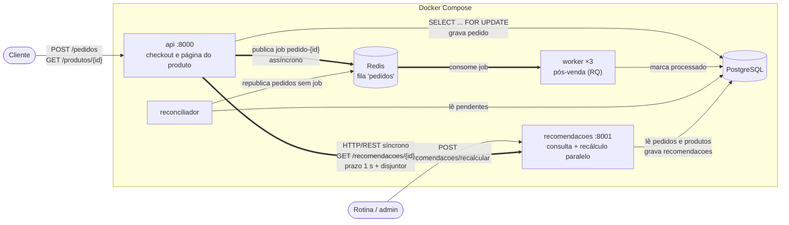

# Origem

Backend do marketplace de artesanato Origem. Este repositório é o projeto
integrado de três disciplinas: começou na FCCPD (fluxo de compra com controle
de concorrência e consistência de estoque, mais a fila assíncrona de
processamento de pedidos) e é também o app monitorado no Projeto Integrador 3
(AED e Infraestrutura de Software).

## Equipe e disciplinas

| Integrante | FCCPD | AED + Infraestrutura de Software (PI3) |
|---|:---:|:---:|
| Aguinaldo Neto (@netokemon) | ✅ | |
| Caliel Feijó (@poeisie) | ✅ | ✅ |
| Elis Tenório (@elistenorio) | ✅ | |
| Eulália Albuquerque (@eulalialbuquerque) | ✅ | ✅ |
| Giulia Ferreira (@giumari18) | ✅ | ✅ |
| Sarah Cyrne (@sarahcyrne) | ✅ | |

O que cada disciplina avalia neste repositório:

| Disciplina | Onde está |
|---|---|
| FCCPD | `app/` (API, fila, worker, reconciliador), `test_concorrencia.py`, `test_fila.py`, `test_resiliencia.py`, `evidencias/` |
| AED (PI3) | `estruturas/` (estruturas de dados, ordenação e busca próprias) e `tests/` |
| Infraestrutura de Software (PI3) | `concorrencia/` (produtor-consumidor e condição de corrida), `scripts/monitor.sh`, Docker/Compose |

Os detalhes do PI3 (stack, mapa de técnicas e como rodar) estão em
[PI3 — AED e Infraestrutura de Software](#pi3--aed-e-infraestrutura-de-software).

## Stack

- **API**: Python + FastAPI + SQLAlchemy
- **Banco**: PostgreSQL 16
- **Fila/broker**: Redis + RQ
- **Orquestração local**: Docker Compose
- **Testes unitários**: pytest

## Como rodar

```bash
docker compose up -d --build --wait
docker compose exec api python -m app.seed      # histórico de compras para as recomendações
curl -X POST "http://localhost:8001/recomendacoes/recalcular?modo=processos"
```

Isso sobe 8 containers: `postgres`, `redis`, `api`, 3 réplicas de `worker`, o
`reconciliador` e o `recomendacoes`. A API fica em `http://localhost:8000` e o
serviço de recomendações em `http://localhost:8001` (`GET /` retorna
`{"status": "ok"}` nos dois). O seed cria 2000 produtos, 10 mil clientes e 80
mil pedidos (dados de desenvolvimento: apaga tudo, menos o produto 1 dos testes).

## Endpoints

**api** (`:8000`)
- `POST /pedidos` — cria um pedido. Recebe `{"produto_id": <int>, "cliente_id": <int, opcional>}`;
  **201** em caso de sucesso, **409** sem estoque, **404** se o produto não existir.
- `GET /pedidos/{pedido_id}` — status do pedido (`"pendente"`, `"processado"` ou `"falhou"`).
- `GET /produtos/{produto_id}?limite=5` — dados do produto e as recomendações, buscadas no
  serviço `recomendacoes`. Se ele estiver fora, responde sem recomendações
  (`"recomendacoes_disponiveis": false`).

**recomendacoes** (`:8001`)
- `GET /recomendacoes/{produto_id}?limite=5` — recomendações pré-calculadas do produto.
- `POST /recomendacoes/recalcular?modo=processos&workers=4` — recalcula todas
  (`modo` = `sequencial`, `threads` ou `processos`) e devolve os tempos de carga,
  cálculo e gravação. **409** se já houver um recálculo em andamento.

## FCCPD Parte 2 (U2) — Arquitetura distribuída e desempenho

Onde está cada item da rubrica:

| Critério | Item verificado | Onde |
|---|---|---|
| 1. Arquitetura distribuída | Diagrama | [Diagrama](#diagrama) |
| | Separação justificada | [Por que cada serviço é separado](#por-que-cada-serviço-é-separado) |
| | Comunicação implementada e demonstrada | [Comunicação](#comunicação-entre-os-serviços) · [`evidencias/u2/comunicacao.txt`](evidencias/u2/comunicacao.txt) · CI |
| 2. Paralelismo com ganho | Processamento paralelo implementado | [`recomendacoes/calculo.py`](recomendacoes/calculo.py) · [Paralelismo](#paralelismo-recálculo-de-recomendações) |
| | Ganho comprovado com números | [Resultados](#resultados) |
| 3. Avaliação de desempenho | Metodologia clara | [Metodologia](#metodologia) |
| | Resultados interpretados | [Interpretação](#interpretação) |

### Diagrama



Setas grossas: comunicação entre serviços (uma síncrona, uma assíncrona).
Setas finas: acesso ao banco e à fila.

### Por que cada serviço é separado

| Serviço | Responsabilidade | Por que existe separado |
|---|---|---|
| `api` | Checkout (baixa de estoque com lock), consulta de pedido, página do produto | É o caminho crítico das vendas: precisa responder rápido e não pode carregar trabalho pesado |
| `worker` (×3) | Pós-venda (simula a emissão de nota fiscal, 3 s) | Trabalho lento fora da requisição: o cliente não espera, e escala com réplicas. Uma falha é retentada sem perder o pedido (Parte 1) |
| `reconciliador` | Republica pedidos que ficaram sem job (Redis fora na hora da compra) | Laço periódico independente; dentro da api rodaria duplicado em cada réplica |
| `recomendacoes` | Consulta e **recálculo** das recomendações | O recálculo compara todos os pares de produtos (4 milhões de comparações com 2000 produtos) e ocupa todos os núcleos por segundos. No mesmo processo da api, deixaria o checkout lento justamente enquanto calcula, e um erro nele derrubaria as vendas. Separado, escala, cai e é atualizado sozinho, e a api trata a queda dele (ver abaixo) |
| `postgres`, `redis` | Banco e broker | Infraestrutura compartilhada |

**O que decidimos não separar:** o banco é compartilhado. O `recomendacoes` só
lê `pedidos` e `produtos` e só escreve na própria tabela (`recomendacoes`), e o
schema de pedidos/produtos é da `api` (o compose só libera o `recomendacoes`
depois que a `api` está saudável). Também não dividimos a `api` em "pedidos" e
"catálogo": seria distribuição sem ganho para o período, risco que o próprio
enunciado aponta.

### Comunicação entre os serviços

| De → para | Tipo | Como | Por que esse tipo |
|---|---|---|---|
| `api` → `recomendacoes` | Síncrona (HTTP/REST) | `GET /recomendacoes/{id}` em [`app/recomendacoes_cliente.py`](app/recomendacoes_cliente.py) | A página do produto precisa da resposta na hora |
| `api` → `worker` | Assíncrona (mensageria, Redis/RQ) | job `pedido-<id>` na fila `pedidos` (Parte 1) | O cliente não precisa esperar o pós-venda |

Cuidados na chamada síncrona, porque recomendação é um extra da página e não
pode derrubá-la:
- **Prazo total de 1 s.** Com o container parado, só a resolução DNS do nome
  `recomendacoes` levava **7,2 s** (medido) e não respeitava o timeout do
  httpx. A chamada roda numa thread à parte e a api espera no máximo 1 s.
- **Disjuntor:** depois de uma falha, a api passa 15 s sem tentar e responde na hora.
- **Fallback:** a página sai com `"recomendacoes_disponiveis": false`, nunca com erro.
- **Rastreio:** cada chamada leva um `X-Request-ID` que aparece no log dos dois
  serviços e no header da resposta.

**Evidência** (trecho de [`evidencias/u2/comunicacao.txt`](evidencias/u2/comunicacao.txt),
gerado por [`evidencia_comunicacao.py`](evidencia_comunicacao.py) a partir dos
logs reais dos containers):

```
GET http://127.0.0.1:8000/produtos/2?limite=3 -> 200  (X-Request-ID: d34cf23a)
    recomenda  1625  Peça de cerâmica 1624        score 0.0649
    ...
  api-1            | INFO:     [d34cf23a] GET http://recomendacoes:8001/recomendacoes/2 -> 200, 3 recomendações em 433 ms
  recomendacoes-1  | ... INFO [recomendacoes] [d34cf23a] Consulta de recomendações do produto 2: 3 encontradas

POST http://127.0.0.1:8000/pedidos -> 201
  worker-2  | 21:18:09 pedidos: app.tasks.processar_pedido(272043) (pedido-272043)
  worker-2  | 21:18:13 pedidos: Job OK (pedido-272043)

$ docker compose stop recomendacoes
GET /produtos/2 (tentativa 1) -> 200 em 1012 ms, recomendacoes_disponiveis=False
GET /produtos/2 (tentativa 2) -> 200 em 6 ms, recomendacoes_disponiveis=False
GET /produtos/2 (tentativa 3) -> 200 em 8 ms, recomendacoes_disponiveis=False
$ docker compose start recomendacoes
GET /produtos/2 depois que o serviço voltou -> 200, recomendacoes_disponiveis=True
```

O mesmo script roda no CI ([`.github/workflows/ci.yml`](.github/workflows/ci.yml))
a cada push, com todos os containers, e o arquivo gerado fica anexado à execução.
Para gerar de novo (containers de pé e seed aplicado):

```bash
python evidencia_comunicacao.py
```

### Paralelismo: recálculo de recomendações

**Tarefa real do produto:** "quem comprou isto também comprou". Para cada
produto A, o serviço compara A com todos os outros produtos B:

```
score(A, B) = Jaccard(compradores de A, compradores de B) × (1 + 0,2 se mesma categoria + 0,1 se mesmo artesão)
Jaccard     = |clientes em comum| / |clientes de A ou de B|
```

e guarda os 10 de maior score. São n·(n−1) comparações independentes e só de
CPU. Com 2000 produtos, são 4 milhões.

> O bônus multiplica em vez de somar. Na primeira versão ele somava (+0,1), o que
> valia mais que a própria similaridade (Jaccard típico entre 0,01 e 0,05): o
> sistema recomendava "do mesmo artesão" em vez de "quem comprou também comprou".

**Onde está o trecho paralelo:** [`recomendacoes/calculo.py`](recomendacoes/calculo.py),
função `calcular()`, que reparte o trabalho, e `calcular_bloco()`, que cada worker executa.

**Como paralelizamos:**
- Os produtos são divididos em blocos contíguos (4 por worker, para equilibrar
  a carga: produtos populares custam mais), e cada worker calcula as
  recomendações de um bloco inteiro.
- **Processos (`ProcessPoolExecutor`), não threads.** No CPython, o GIL deixa
  só uma thread executar Python por vez, então threads não aceleram trabalho de
  CPU. Cada processo tem o próprio interpretador e o próprio GIL. O modo
  `threads` existe só para o benchmark comprovar isso.
- Os dados vão para cada processo **uma vez**, no `initializer` do pool, e não a
  cada bloco. Cada bloco devolve só o seu top-10, então o que volta é pequeno.
- Os processos são criados com `spawn`, e não com `fork`, porque o servidor já tem
  threads rodando e fazer fork de um processo com threads pode travar. O custo
  disso foi medido (experimento D).
- O banco é lido uma vez no processo principal ([`recomendacoes/servico.py`](recomendacoes/servico.py)).
  Os processos filhos não abrem conexão.
- O resultado paralelo é **idêntico** ao sequencial: há teste para isso
  ([`tests/test_recomendacoes_calculo.py`](tests/test_recomendacoes_calculo.py)),
  e o benchmark confere em todas as configurações.

### Metodologia

| | |
|---|---|
| **O que foi medido** | Tempo de `calcular()` (o trecho paralelo), **incluindo** a criação e o encerramento do pool de threads/processos, porque esse custo existe em todo recálculo. A leitura do banco e a gravação ficam de fora, porque são iguais nos três modos (tratadas na interpretação, item 5). Métricas derivadas: **vazão** (comparações de pares por segundo), **speedup** (tempo sequencial ÷ tempo do modo) e **eficiência** (speedup ÷ nº de workers) |
| **Como** | Script [`recomendacoes/benchmark.py`](recomendacoes/benchmark.py), rodando num container da mesma imagem do serviço, isolado (`docker compose run --no-deps`) |
| **Volume de dados** | 250, 500, 1000, 2000 e 4000 produtos (de 62 mil a 16 milhões de comparações), gerados pelo mesmo gerador do seed (`app.seed.gerar_dados`, semente 42, clientes = 5·n, pedidos = 40·n). Mesma semente → mesmos dados em toda execução |
| **Repetições** | 1 execução de aquecimento descartada + **5 medições** por configuração. Reportamos a **mediana** (menos sensível a picos), o mínimo, o máximo e o desvio padrão |
| **Configurações** | **A:** volume variando, com 4 workers, nos três modos. **B:** 2000 produtos (o volume do seed), com 1 a 8 workers. **C, D e E:** diagnósticos para explicar onde o ganho se perde (teto do hardware, custo de criar processos, disputa entre processos) |
| **Correção** | O resultado de threads e processos foi comparado com o sequencial em **todas** as configurações: idêntico |
| **Máquina** | Notebook Intel Core i5-1035G1 (4 núcleos físicos, 8 lógicos, 1,0 GHz base / 3,6 GHz turbo), na tomada; Windows 11 + Docker Desktop (WSL2); container com 8 CPUs e 3,7 GB; Python 3.12.16 |

```bash
docker compose run --rm --no-deps -v ./evidencias:/code/evidencias recomendacoes python -m recomendacoes.benchmark
```

Saída completa (todas as tabelas, desvio, mín–máx e vazão):
[`evidencias/u2/benchmark.md`](evidencias/u2/benchmark.md); cada medição individual:
[`evidencias/u2/benchmark.csv`](evidencias/u2/benchmark.csv).

### Resultados

**A — efeito do volume** (4 workers; tempo mediano do cálculo; speedup entre parênteses)

| Produtos | Comparações | Sequencial | Threads ×4 | Processos ×4 |
|---:|---:|---:|---:|---:|
| 250 | 62 mil | 0,046 s | 0,060 s (0,76×) | 0,210 s (**0,22×**) |
| 500 | 250 mil | 0,285 s | 0,276 s (1,03×) | 0,405 s (**0,70×**) |
| 1000 | 1 milhão | 1,165 s | 1,137 s (1,02×) | 1,147 s (1,02×) |
| 2000 | 4 milhões | 3,699 s | 4,088 s (0,90×) | 1,607 s (**2,30×**) |
| 4000 | 16 milhões | 14,014 s | 13,780 s (1,02×) | 4,821 s (**2,91×**) |

**B — efeito do nº de workers** (2000 produtos; sequencial = 4,102 s)

| Workers | Threads | Processos | Eficiência dos processos |
|---:|---:|---:|---:|
| 1 | — | 3,378 s (1,21×) | — |
| 2 | 4,145 s (0,99×) | 2,112 s (1,94×) | 0,97 |
| 4 | 3,714 s (1,10×) | **1,540 s (2,66×)** | 0,67 |
| 6 | — | 1,771 s (2,32×) | 0,39 |
| 8 | 3,762 s (1,09×) | 2,403 s (1,71×) | 0,21 |

**Diagnóstico** (C, D e E)

| Workers | C: speedup de um laço puro de CPU (teto do hardware) | D: custo de criar e encerrar o pool | E: tempo do mesmo bloco de 100 produtos com N workers ao mesmo tempo |
|---:|---:|---:|---:|
| 1 | 0,81× | 0,170 s | 0,183 s (1,00×) |
| 2 | 1,12× | 0,169 s | 0,199 s (1,09×) |
| 4 | 2,31× | 0,243 s | 0,338 s (1,85×) |
| 6 | 2,68× | 0,323 s | 0,375 s (2,05×) |
| 8 | 2,34× | 0,536 s | 0,432 s (2,36×) |

**Resumo:** no volume do seed (2000 produtos), o cálculo caiu de **3,7–4,1 s
para 1,5–1,6 s** com 4 processos (**2,3× a 2,7×**). Com 4000 produtos, caiu de
**14,0 s para 4,8 s (2,9×)**. Threads não ganharam em nenhum caso.

### Interpretação

1. **Threads não ganham (0,76× a 1,10× em todos os casos): é o GIL.** O cálculo
   é 100% CPU em código Python, e o GIL deixa só uma thread executar por vez.
   As threads se revezam em vez de rodar juntas, e ainda pagam o custo de trocar
   de uma para outra. Isso confirma a decisão de usar **processos**.

2. **Com pouco volume, paralelizar piora: com 250 produtos, processos foram
   4,5× mais lentos (0,22×).** Criar e encerrar 4 processos custa ~0,24 s
   (experimento D), mais que o cálculo inteiro (0,046 s). O ponto de equilíbrio
   ficou em torno de **1000 produtos** (1,02×). Abaixo disso, o modo
   `sequencial` (disponível no endpoint) é a melhor escolha.

3. **O ganho cresce com o volume (2,30× com 2000, 2,91× com 4000).** O
   trabalho cresce com n², enquanto o custo de criar os processos é fixo. Quanto
   maior o catálogo, mais esse custo fixo se dilui e mais o speedup se aproxima
   do teto da máquina. Para o marketplace, que só cresce, o paralelo vale cada
   vez mais.

4. **O melhor foi 4 workers, que é o número de núcleos físicos. Com 6 e 8, piorou
   (2,32× e 1,71×).** Três causas, cada uma medida:
   - **Hyperthreading não é núcleo de verdade.** Os 8 "núcleos" do container
     são 4 físicos com 2 threads de hardware cada, dividindo as mesmas unidades
     de execução. Mesmo num laço puro de CPU, a máquina não passou de ~2,3–2,7×
     (experimento C).
   - **Disputa por cache e memória.** O mesmo bloco de trabalho fica 1,85× mais
     lento com 4 processos ao mesmo tempo e 2,36× com 8 (experimento E).
     Comparar conjuntos de clientes é acessar memória espalhada, e os núcleos
     dividem o mesmo cache L3 (6 MB) e o mesmo barramento de memória. Por isso a
     eficiência cai de 0,97 (2 workers) para 0,67 (4) e 0,21 (8).
   - **Custo de criar os processos** sobe de 0,17 s (1–2 workers) para 0,54 s (8)
     (experimento D).

   **Decisão tomada a partir disso:** o serviço usava `os.cpu_count()` (8)
   workers por padrão. Passou a usar **4**, configurável por
   `RECOMENDACOES_WORKERS` no [`docker-compose.yml`](docker-compose.yml).

5. **Lei de Amdahl: o recálculo completo ganha menos que o cálculo.** Pelo
   endpoint, o recálculo também lê o banco (~0,3–0,7 s) e grava 20 mil linhas
   (~0,8–0,9 s), partes que continuam sequenciais. Numa execução com a máquina
   já aquecida, o total foi de **7,8 s (sequencial) para 3,3 s (4 processos)**:
   o cálculo caiu 2,8× (6,1 → 2,2 s), mas o total caiu 2,4×. Paralelizar
   a gravação não compensaria: é uma única transação no banco, justamente para
   quem consulta não ver a tabela pela metade.

6. **Variação da máquina.** Notebook reduz a frequência quando esquenta: a
   mesma configuração variou até ~15% entre rodadas (o sequencial com 2000
   produtos deu 3,70 s no experimento A e 4,10 s no B; num teste à parte, foi de
   3,49 s para 4,12 s depois de alguns minutos de carga). Por isso usamos
   mediana de 5 medições e publicamos mínimo e máximo. O "1 processo mais rápido
   que o sequencial" (1,21×) está dentro dessa variação. Testamos se era o
   coletor de lixo do Python, e desligá-lo mudou só 2%. Os ganhos de 2,3× a 2,9×
   são bem maiores que esse ruído, então as conclusões se mantêm.

7. **Relação com a arquitetura.** O recálculo ocupa todos os núcleos por
   segundos. Esse é o motivo de ele estar num serviço separado da `api`: o
   checkout não divide processo, memória nem falhas com ele. Nesta máquina os
   containers ainda dividem os mesmos núcleos físicos. Em produção, o
   `recomendacoes` iria para uma máquina própria ou teria limite de CPU, algo
   que a separação em serviços permite fazer sem tocar na `api`.

## FCCPD Parte 1 — Concorrência no checkout e fila assíncrona

### Critério 1 — Controle de concorrência

O `produto` é bloqueado a nível de linha antes da leitura/atualização do estoque,
usando lock pessimista do PostgreSQL (`SELECT ... FOR UPDATE` via
`with_for_update()` do SQLAlchemy). Enquanto uma transação segura o lock, qualquer
outra transação concorrente que tente ler a mesma linha fica bloqueada até o
`COMMIT` (ou `ROLLBACK`) da primeira.

**Por que lock pessimista, e não lock otimista:** o Origem vende peças únicas de
artesanato, então a disputa pelo estoque acontece de forma pontual — no exato
momento em que duas pessoas clicam em "comprar" ao mesmo tempo. Lock otimista
exigiria implementar lógica de retry no cliente (detectar conflito de versão,
tentar de novo), o que complicaria o MVP sem trazer ganho real para esse cenário
de disputa curta e pouco frequente. Lock pessimista resolve com uma linha de
código e garante correção imediata.

### Critério 2 — Consistência de estoque sob concorrência

A prova de que o estoque se mantém correto sob concorrência está no
[teste de concorrência](#como-rodar-o-teste-de-concorrência) abaixo, que dispara
50 requisições simultâneas contra um produto com 10 unidades em estoque e confere
o resultado tanto pelas respostas HTTP quanto pelo estado real do PostgreSQL.

### Critério 3 — Publicação de eventos (produtor)

Ao criar um pedido, o `POST /pedidos` não faz o processamento pós-venda (ex.:
emissão de nota fiscal, notificação ao vendedor) de forma síncrona. O pedido
nasce com `status="pendente"`, a API responde **201** imediatamente e só depois
de enviar a resposta publica um job na fila `pedidos` do Redis/RQ
(`publicar_pedido` em `app/queue.py`). Cada job:

- tem um id fixo por pedido (`pedido-<id>`), o que permite saber se um pedido
  já está na fila sem publicá-lo em duplicidade;
- referencia a tarefa pelo caminho (`"app.tasks.processar_pedido"`), então a
  API não precisa importar o código do worker;
- é reexecutado automaticamente se falhar (`Retry(max=3, interval=[5, 15, 30])`).

### Critério 4 — Desacoplamento e integridade das mensagens (consumidor)

O serviço `worker` (`app/worker.py`) roda um `Worker` do RQ escutando a fila
`pedidos`, em um processo completamente separado da API. Quando consome um
evento, ele executa `processar_pedido` (`app/tasks.py`), que simula o trabalho
pesado e atualiza o pedido para `status="processado"`. Rodamos 3 réplicas desse
worker em paralelo (`--scale worker=3`), então vários pedidos são processados
simultaneamente em vez de um por vez — a fila escala horizontalmente só
adicionando mais réplicas, sem mudar nada no código.

**A fila não segura a loja.** A compra é efetivada no PostgreSQL (estoque
baixado e pedido gravado na mesma transação) antes de qualquer coisa ir para a
fila, e a publicação só acontece depois que a resposta foi enviada. Por isso,
nem um Redis lento nem um Redis fora do ar atrasam ou derrubam uma compra.

**Nenhum pedido se perde.** O banco é a fonte da verdade, e cada falha possível
tem um tratamento:

| O que falha | O que acontece |
|---|---|
| Redis fora na hora da compra | A compra responde 201 normalmente e o pedido fica `pendente`. O **reconciliador** (`app/reconciliador.py`, container próprio) procura a cada 5 s pedidos pendentes há mais de 10 s sem job no Redis e os publica quando a fila volta. Um disjuntor na API para de tentar o Redis por 15 s depois de uma falha, para não prender threads da loja tentando conectar. |
| Redis reinicia com jobs na fila | O Redis roda com `--appendonly yes`: a fila é gravada em disco e sobrevive ao reinício. O que se perder no último segundo antes de uma queda é coberto pelo reconciliador. |
| Job falha (ex.: banco fora durante o processamento) | O RQ tenta de novo até 3 vezes, esperando 5 s, 15 s e 30 s. Se todas falharem, o callback `marcar_pedido_como_falho` marca o pedido como `falhou` (visível no `GET /pedidos/{id}`), em vez de ele ficar `pendente` para sempre. |
| Worker morre no meio de um job | Na limpeza periódica dos registros, o RQ detecta o job abandonado e aplica o mesmo retry. |
| O mesmo pedido chega duas vezes (retry, reconciliador) | A tarefa é idempotente: só trabalha em pedidos ainda `pendente` e marca `processado` com um UPDATE condicional, então a nota fiscal não é emitida duas vezes. |

A prova de que isso funciona está no [teste de resiliência](#como-rodar-o-teste-de-resiliência-redis-fora-do-ar).

### Como rodar o teste de concorrência

Com os containers de pé (`docker compose up -d`), no host (fora do container):

```bash
pip install httpx
python test_concorrencia.py --controle-negativo
```

O script:
1. Reseta o produto de teste (`id=1`) com estoque conhecido (10 unidades);
2. Dispara 50 requisições `POST /pedidos` simultâneas contra ele;
3. Confere via `docker compose exec postgres psql` o estoque final e o número de
   pedidos criados no banco;
4. Falha (exit code ≠ 0) se qualquer número não bater com o esperado.

Com `--controle-negativo`, antes do teste real ele repete o mesmo ataque contra
uma segunda instância da API (container temporário na porta 8001) em que o
`with_for_update()` foi desligado só dentro dela, sem mudar o código do
projeto. Sem essa flag, roda só o teste real.

#### Relatório de teste (evidência — Critério 5)

```
=== CONTROLE NEGATIVO: MESMO ATAQUE CONTRA A API SEM LOCK ===
Sucessos (201 Created): 49 | Conflitos (409): 1 | Outros: 0
Estoque Final no PostgreSQL: 0
Pedidos Criados no PostgreSQL: 49
-> Sem o lock: 39 unidade(s) vendida(s) além do estoque e 39 baixa(s) de estoque perdida(s) (lost update).
-> O teste DETECTA a condição de corrida quando o lock é removido.

=== RELATÓRIO DE TESTE DE CONCORRÊNCIA ===
Estoque Inicial: 10
Requisições Simultâneas: 50

--- RESULTADOS HTTP ---
Sucessos (201 Created): 10
Conflitos (409 Conflict): 40
Erros Inesperados: 0

--- VERIFICAÇÃO NO BANCO DE DADOS ---
Estoque Final no PostgreSQL: 0
Pedidos Criados no PostgreSQL: 10

✅ VEREDITO: O sistema manteve a consistência sob alta concorrência. Zero erros.
```

De 50 tentativas simultâneas para um produto com 10 unidades, exatamente 10
pedidos foram criados e 40 foram rejeitados por falta de estoque, com o estoque
final zerado — nenhuma venda duplicada, nenhum estoque negativo.

O controle negativo mostra por que isso importa: com o mesmo ataque e sem o
lock, 49 compras foram aceitas para um estoque de 10 (39 peças únicas vendidas
a mais) e 39 baixas de estoque se perderam. Isso prova que o teste consegue
detectar a condição de corrida, então o resultado perfeito da API real vem do
lock, e não de sorte.

### Como rodar o teste da fila

Com os containers de pé, incluindo os 3 workers (`docker compose up -d --scale worker=3`):

```bash
docker compose cp test_fila.py api:/code/test_fila.py
docker compose exec api python test_fila.py
```

O script:
1. Reseta o produto de teste (`id=1`) com estoque conhecido;
2. Dispara 5 requisições `POST /pedidos`;
3. Confirma que cada compra responde 201 já com `status="pendente"` e em menos
   de 500 ms, enquanto cada job leva 3 s (prova de que a compra não espera o
   processamento);
4. Faz polling no PostgreSQL até todos os pedidos virarem `"processado"` ou
   estourar um timeout de 30s;
5. Falha se alguma dessas condições não for atendida.

#### Relatório de teste (evidência — Critérios 3 e 4)

```
=== RELATÓRIO DE TESTE DA FILA ===
Pedidos criados: 5 (todos responderam 201 com status 'pendente')
Latência do POST /pedidos: mín 29 ms | mediana 43 ms | máx 54 ms (cada job leva 3000 ms)
Todos processados pelos workers em 10.1s (limite: 30s)

[OK] 5 pedidos criados, todos processados pelo worker em até 30s, sem a compra esperar pelo processamento.
```

Os 5 pedidos foram criados com `status="pendente"` em no máximo 54 ms, cerca de
55 vezes mais rápido que o trabalho de 3 s de cada job. Com 3 workers RQ
consumindo a fila em paralelo, todos migraram para `status="processado"` dentro
do prazo, confirmando que o processamento acontece de fato fora do ciclo da
requisição HTTP.

### Como rodar o teste de resiliência (Redis fora do ar)

Com os containers de pé, no host (fora do container), assim como o teste de
concorrência:

```bash
python test_resiliencia.py
```

O script:
1. Reseta o produto de teste (`id=1`) com estoque conhecido (10 unidades);
2. Derruba o Redis (`docker compose stop redis`) e faz 5 compras;
3. Confirma que todas responderam 201 em menos de 1 s, que os 5 pedidos estão
   `"pendente"` no banco e que o estoque baixou exatamente 5 unidades;
4. Religa o Redis (sempre, mesmo se o teste falhar) e espera o reconciliador e
   os workers levarem todos os pedidos a `"processado"`;
5. Falha se alguma dessas condições não for atendida.

#### Relatório de teste (evidência — Critério 4)

```
=== RELATÓRIO DE TESTE DE RESILIÊNCIA (REDIS FORA DO AR) ===
Compras feitas com o Redis desligado: 5

--- COM O REDIS FORA ---
Respostas 201 Created: 5 | Outras: []
Latência do POST /pedidos: mediana 77 ms | máx 107 ms
Pedidos 'pendente' no PostgreSQL: 5
Estoque no PostgreSQL: 10 -> 5

--- DEPOIS DE RELIGAR O REDIS ---
Pedidos 'processado': 5 de 5 em 16.1s (republicados pelo reconciliador)

✅ VEREDITO: Com o Redis fora, a loja continuou vendendo e nenhum pedido se perdeu.
```

Antes dessas mudanças, o mesmo cenário devolvia **HTTP 500 depois de ~7 s**,
embora a compra já tivesse sido gravada: o estoque baixava, o pedido ficava
`pendente` para sempre e o cliente, vendo o erro, tentaria comprar de novo.

### Evidências completas (Critério 5)

Os relatórios acima são de uma única execução de cada teste. A pasta
[`evidencias/`](evidencias/RESUMO.md) reúne uma bateria completa, gerada por um
script a partir dos próprios testes (nada é copiado à mão):

- 5 rodadas do teste de concorrência, cada uma com o controle negativo;
- o teste da fila e o teste de resiliência;
- a linha do tempo da queda do Redis, extraída dos logs dos containers, que
  mostra as compras respondidas com 201, o reconciliador republicando os
  pedidos órfãos e os workers processando cada um;
- o ambiente: data, commit testado, versões e containers.

Com os containers de pé, no host:

```bash
python gerar_evidencias.py
```

## PI3 — AED e Infraestrutura de Software

### Stack e justificativa

Mantivemos **Python 3.12** porque o app monitorado (este backend) já é Python, e
a linguagem atende às quatro exigências do PI3:

| Exigência do PI3 | Como o Python atende |
|---|---|
| Estruturas, ordenação e busca próprias | Classes com nós encadeados e um bloco de tamanho fixo `[None] * n` como array. Nas partes avaliadas não usamos `list.append/pop/sort`, `dict`, `set`, `deque`, `sorted` nem `bisect` |
| Threads e primitivas de sincronização | Módulo `threading` (`Thread`, `Lock`, `Condition`) |
| Comandos do SO ou leitura de `/proc` | `subprocess` e leitura direta de arquivos em `/proc`; o Lab 09 é em Bash (`top`, `ps`, `pgrep`) |
| Rodar em container Linux e no CI | Imagem `python:3.12-slim` (já usada no Compose); testes com pytest, sem dependências externas, prontos para o GitHub Actions (próximo checkpoint) |

**Limitação conhecida — o GIL:** no CPython só uma thread executa bytecode Python
por vez. Isso não atrapalha o coletor do monitor, que passa a maior parte do
tempo esperando I/O (ler `/proc`, chamar a API do Docker, fazer health checks),
e durante a espera o GIL é liberado. Já para trabalho pesado de CPU (o cálculo
de recomendações da FCCPD) usamos **processos** em vez de threads.

### Mapa de técnicas

| Técnica | Onde | Por quê | Complexidade | Status |
|---|---|---|---|---|
| Lista encadeada | `estruturas/lista.py`; usada em `estruturas/ordenacao.py` | Copiar uma entrada de tamanho desconhecido (até um gerador) em uma única passada | inserir no início/fim O(1); buscar O(n) | ✅ |
| Pilha | `estruturas/pilha.py`; usada em `estruturas/arvore_busca.py` | Percorrer a árvore sem recursão, que estouraria no caso degenerado (altura = n) | empilhar/desempilhar O(1) | ✅ |
| Fila | `estruturas/fila.py` | FIFO sem limite; timeline de eventos do monitor | enfileirar/desenfileirar O(1) | ✅ implementada; uso no monitor 🔜 |
| Fila circular | `estruturas/fila_circular.py`; usada em `concorrencia/buffer.py` | Buffer do produtor-consumidor com memória fixa; no monitor, janela das últimas N amostras | todas as operações O(1); memória O(capacidade) | ✅ |
| Tabela hash | `estruturas/tabela_hash.py` | Acesso por chave em O(1): estado por serviço/container no monitor, clientes por produto nas recomendações | O(1) médio, O(n) pior; redimensiona com fator de carga 0,75 | ✅ implementada; uso 🔜 |
| Árvore binária de busca | `estruturas/arvore_busca.py` | Eventos ordenados por timestamp, com consulta por intervalo | O(h): ~O(log n) aleatório, O(n) degenerada | ✅ implementada; uso 🔜 |
| Insertion / selection sort | `estruturas/ordenacao.py` | Base de comparação; insertion também é usado pelo quick sort em trechos com menos de 16 elementos | O(n²) (insertion: O(n) se quase ordenado) | ✅ |
| Top-K (insertion sort parcial) | `estruturas/top_k.py`; usado em `recomendacoes/calculo.py` | As 10 melhores recomendações entre ~2000 candidatos sem ordenar todos: quem não supera o 10º é descartado em O(1) | O(n·k) pior, ~O(n) na prática; memória O(k) | ✅ |
| Merge sort | `estruturas/ordenacao.py` | Timeline de eventos do monitor por horário: estável, então eventos do mesmo segundo mantêm a ordem de chegada | O(n log n) sempre; memória O(n) | ✅ implementado; uso 🔜 |
| Quick sort | `estruturas/ordenacao.py` | Ordenar processos/containers por CPU ou memória no monitor; pivô mediana de três | O(n log n) médio; pilha O(log n) | ✅ implementado; uso 🔜 |
| Busca sequencial / binária | `estruturas/busca.py` | Sequencial em dados não ordenados; binária para achar amostras por timestamp no histórico ordenado | O(n) / O(log n) | ✅ implementada; uso 🔜 |
| Produtor-consumidor com `Lock` + 2 `Condition` | `concorrencia/buffer.py` | Produtores dormem com o buffer cheio e consumidores com ele vazio, sem espera ocupada | colocar/retirar O(1) | ✅ |
| Condição de corrida mostrada e corrigida (threads) | `concorrencia/estatisticas.py`, `concorrencia/demo_corrida.py` | "ler → somar → gravar" não é atômico; o `Lock` torna a seção crítica exclusiva | — | ✅ |
| Condição de corrida mostrada e corrigida (banco) | `app/main.py` (`SELECT ... FOR UPDATE`), `test_concorrencia.py --controle-negativo` | Duas compras simultâneas do último item; sem o lock, vende a mais | — | ✅ (FCCPD Parte 1) |
| Monitoramento via comandos do SO | `scripts/monitor.sh` | CPU/memória via `top`; RSS, threads e estado via `ps` | — | ✅ |

✅ = implementado e testado · 🔜 = planejado para os próximos passos (coletor e
dashboard do monitor, recomendações da FCCPD)

### Como rodar os testes e a demonstração

Os testes unitários rodam sem Docker:

```bash
pip install -r requirements-dev.txt
pytest                                  # estruturas, ordenação, busca e produtor-consumidor
python -m concorrencia.demo_corrida     # mesma carga sem lock x com lock
```

Saída da demonstração (3 produtores × 2000 itens, 3 consumidores):

```
[SEM lock] total=1945 soma=5659166 perdidas=4055 (67.6%) -> ERRADO (condição de corrida)
[COM lock] total=6000 soma=18003000 perdidas=0 (0.0%)    -> CORRETO
```

O número de atualizações perdidas sem lock muda a cada execução; com lock o
resultado é sempre exato. Para a corrida aparecer de forma reproduzível, a
seção crítica cede a CPU no meio com `time.sleep(0)`: no CPython, por causa do
GIL, a troca de thread no meio de um `x = x + 1` é rara, e o bug ficaria
intermitente. O `Lock` corrige com ou sem esse `sleep`.

### Monitor de processo — `scripts/monitor.sh` (Lab 09)

Script Bash que mede CPU e memória (via `top`) e RSS, threads e estado (via
`ps`) de um processo, grava as medições em CSV, registra alertas quando a CPU
passa do limite e imprime um resumo no final. Roda em Linux.

```bash
./scripts/monitor.sh <PID|nome> [intervalo_s] [amostras] [limite_cpu]
./scripts/monitor.sh postgres          # padrão: 1 s, 30 amostras, alerta acima de 80%
./scripts/monitor.sh 1234 0.5 60 50
```

- Se o argumento não for numérico, o PID é descoberto com `pgrep -o`.
- Gera `medicoes_<nome>_<data>.csv` (`timestamp,pid,cpu,mem,rss_kb,threads,estado`)
  e acrescenta os alertas em `alertas.log`, ambos no diretório atual.
- Para sozinho se o processo terminar; `Ctrl+C` também imprime o resumo
  (amostras, CPU média e máxima, RSS médio, máximo de threads).

## Declaração de uso de Inteligência Artificial (Critério 6)

Usamos o **Claude** (Anthropic) para revisar o código do endpoint de pedidos,
projetar o script de teste de concorrência, implementar a fila assíncrona de
processamento (produtor/consumidor com Redis/RQ) e depurar problemas de
ambiente durante o desenvolvimento.

Um exemplo de sugestão da IA que precisou ser corrigida: a primeira versão do
`test_concorrencia.py` verificava `status_code == 200` para contar sucessos, mas
o endpoint `POST /pedidos` retorna **201 Created**. Isso fazia o teste registrar
falsamente todos os pedidos bem-sucedidos como "erros inesperados". Percebemos a
inconsistência ao comparar o código do `main.py` com a lógica do teste, e
corrigimos a verificação para `status_code == 201`.

Outro ajuste feito durante a depuração: a primeira abordagem do teste conectava
diretamente ao PostgreSQL via SQLAlchemy/psycopg2 a partir do Windows, mas isso
esbarrou em um bug de locale do psycopg2 no Windows (erro de decodificação ao
tentar reportar falhas de conexão em português). Em vez de insistir nessa rota,
optamos por rodar as verificações de estado do banco via `docker compose exec
postgres psql`, o que eliminou o problema por completo.

Na implementação da fila, a IA também errou de início: ao adicionar o campo
`status` na resposta do `POST /pedidos`, a sugestão inicial só criou o novo
schema `PedidoStatusResponse` (para o `GET /pedidos/{id}`) mas esqueceu de
adicionar o campo `status` no `PedidoResponse` já existente. O código rodava
sem erro, só que a resposta da criação do pedido vinha sem o campo — o Pydantic
descarta silenciosamente valores que não estão declarados no schema. Também
identificamos, ao rodar o `test_fila.py` pela primeira vez, que o timeout
inicial de 15s era curto demais para 5 pedidos processados sequencialmente por
um único worker (cada um simula 3s de trabalho); além de aumentar o timeout
para 30s, escalamos para 3 workers em paralelo (`--scale worker=3`), o que
também deixou mais evidente a capacidade da fila de escalar horizontalmente.

Na revisão final, usamos o Claude (via Claude Code) para auditar o projeto
contra a rubrica. Rodando os testes e derrubando o Redis de propósito, ele
encontrou um acoplamento que nossos testes não cobriam: com o Redis fora, o
`POST /pedidos` devolvia **500** depois de ~7 s, embora a compra já estivesse
gravada, o que deixava o pedido `pendente` para sempre e levaria o cliente a
comprar de novo. A partir disso, a IA implementou a publicação na fila depois
da resposta, o disjuntor, o reconciliador, o retry com callback de falha
(status `falhou`) e a idempotência da tarefa, além do controle negativo no
`test_concorrencia.py`, do `test_resiliencia.py` e do `gerar_evidencias.py`.

A primeira proposta da IA para esse problema também estava incompleta: ela
sugeriu apenas configurar timeouts curtos na conexão com o Redis. Ao medir,
vimos que a demora vinha da resolução DNS do host `redis` (~4 s com o
container parado), que não respeita esses timeouts. Por isso foram adicionados
o disjuntor e a publicação depois da resposta. A IA também verificou no
código-fonte do RQ 1.16 que o worker não podia usar a mesma conexão com timeout
curto (isso quebraria a espera bloqueante por jobs), e por isso o worker tem
uma conexão própria.
