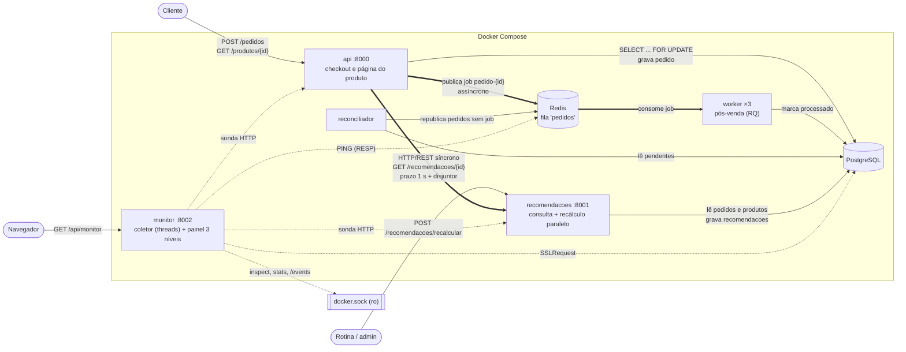
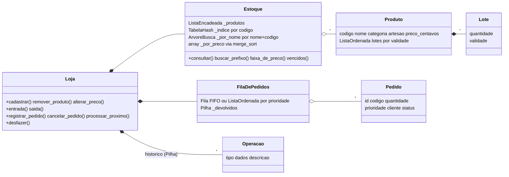

# Origem


Backend do marketplace de artesanato Origem, projeto integrado de três
disciplinas: [**FCCPD**](#fccpd-parte-2-u2--arquitetura-distribuída-e-desempenho),
[**AED**](#aed) e [**Infraestrutura de Software**](#infraestrutura-de-software)
(as duas aparecem rodando no [painel do monitor](#painel-do-monitor-aed--infra)).

**FCCPD:** Aguinaldo Neto, Caliel Feijó, Elis Tenório, Eulália Albuquerque, Giulia Ferreira e Sarah Cyrne  
**AED e Infraestrutura de Software:** Caliel Feijó, Eulália Albuquerque e Giulia Ferreira

## Como rodar

```bash
docker compose up -d --build --wait
docker compose exec api python -m app.seed      # histórico de compras para as recomendações
curl -X POST "http://localhost:8001/recomendacoes/recalcular?modo=processos"
```

Sobe 9 containers: `postgres`, `redis`, `api` (`:8000`), 3 réplicas de
`worker`, `reconciliador`, `recomendacoes` (`:8001`) e `monitor` (`:8002`, o [painel](#painel-do-monitor-aed--infra) em 3 níveis).
Todos têm `mem_limit`. Containers que já existiam só pegam os limites ao serem recriados (`docker compose up -d`). O seed cria 2000
produtos, 10 mil clientes e 80 mil pedidos (apaga tudo, menos o produto 1 dos testes).

## Endpoints

| Serviço | Rota | O que faz |
|---|---|---|
| api | `POST /pedidos` | Cria pedido (`{"produto_id", "cliente_id"?}`): **201**, **409** sem estoque, **404** produto inexistente |
| api | `GET /pedidos/{id}` | Status: `pendente`, `processado` ou `falhou` |
| api | `GET /produtos/{id}?limite=5` | Produto + recomendações (se o serviço cair: `"recomendacoes_disponiveis": false`) |
| recomendacoes | `GET /recomendacoes/{id}?limite=5` | Recomendações pré-calculadas |
| recomendacoes | `POST /recomendacoes/recalcular?modo=processos&workers=4` | Recalcula tudo (`sequencial`, `threads` ou `processos`); **409** se já houver recálculo |

## FCCPD Parte 2 (U2) — Arquitetura distribuída e desempenho

| Critério | Item verificado | Onde |
|---|---|---|
| 1. Arquitetura distribuída | Diagrama | [Diagrama](#diagrama) |
| | Separação justificada | [Por que cada serviço é separado](#por-que-cada-serviço-é-separado) |
| | Comunicação implementada e demonstrada | [Comunicação](#comunicação-entre-os-serviços) · [`evidencias/u2/comunicacao.txt`](evidencias/u2/comunicacao.txt) · CI |
| 2. Paralelismo com ganho | Processamento paralelo implementado | [`recomendacoes/calculo.py`](recomendacoes/calculo.py) · [Paralelismo](#paralelismo-recálculo-de-recomendações) |
| | Ganho comprovado com números | [Resultados](#resultados) |
| 3. Avaliação de desempenho | Metodologia clara | [Metodologia](#metodologia) |
| | Resultados interpretados | [Interpretação](#interpretação) |

### Diagrama



Setas grossas: comunicação entre serviços (uma síncrona, uma assíncrona). Setas finas: acesso ao banco e à fila.
Pontilhadas: monitoramento (PI3), que só observa; o `/proc` da máquina chega ao monitor via `pid: host`.

### Por que cada serviço é separado

| Serviço | Responsabilidade | Por que existe separado |
|---|---|---|
| `api` | Checkout (baixa de estoque com lock), pedidos, página do produto | Caminho crítico das vendas: precisa responder rápido |
| `worker` (×3) | Pós-venda (simula nota fiscal, 3 s) | Trabalho lento fora da requisição; escala com réplicas e tem retry (Parte 1) |
| `reconciliador` | Republica pedidos que ficaram sem job | Laço periódico; dentro da api rodaria duplicado em cada réplica |
| `recomendacoes` | Consulta e **recálculo** das recomendações | O recálculo (4 milhões de comparações) ocupa todos os núcleos por segundos. Separado, não deixa o checkout lento nem o derruba se falhar, e escala sozinho |
| `postgres`, `redis` | Banco e broker | Infraestrutura compartilhada |

**O que não separamos:** o banco é compartilhado (o `recomendacoes` só escreve
na própria tabela), e a `api` não foi dividida em "pedidos" e "catálogo":
seria distribuição sem ganho, risco que o próprio enunciado aponta.

### Comunicação entre os serviços

| De → para | Tipo | Como | Por quê |
|---|---|---|---|
| `api` → `recomendacoes` | Síncrona (HTTP/REST) | `GET /recomendacoes/{id}` em [`app/recomendacoes_cliente.py`](app/recomendacoes_cliente.py) | A página do produto precisa da resposta na hora |
| `api` → `worker` | Assíncrona (Redis/RQ) | job `pedido-<id>` na fila `pedidos` | O cliente não espera o pós-venda |

A recomendação é um extra e não pode derrubar a página:
- **Prazo de 1 s** (com o container parado, só o DNS levava 7,2 s e ignorava o timeout do httpx).
- **Disjuntor** de 15 s depois de uma falha e **fallback** com `"recomendacoes_disponiveis": false`.
- **`X-Request-ID`** em cada chamada, visível no log dos dois serviços.

**Evidência** (trecho de [`evidencias/u2/comunicacao.txt`](evidencias/u2/comunicacao.txt),
gerado por [`evidencia_comunicacao.py`](evidencia_comunicacao.py) a partir dos logs reais):

```
GET http://127.0.0.1:8000/produtos/2?limite=3 -> 200  (X-Request-ID: 44f3adb0)
    recomenda  1625  Peça de cerâmica 1624        score 0.0667
    ...
  api-1            | INFO:     [44f3adb0] GET http://recomendacoes:8001/recomendacoes/2 -> 200, 3 recomendações em 32 ms
  recomendacoes-1  | ... INFO [recomendacoes] [44f3adb0] Consulta de recomendações do produto 2: 3 encontradas

POST http://127.0.0.1:8000/pedidos -> 201
  worker-3  | 16:06:06 pedidos: app.tasks.processar_pedido(81057) (pedido-81057)
  worker-3  | 16:06:10 pedidos: Job OK (pedido-81057)

$ docker compose stop recomendacoes
GET /produtos/2 (tentativa 1) -> 200 em 1112 ms, recomendacoes_disponiveis=False
GET /produtos/2 (tentativa 2) -> 200 em 13 ms, recomendacoes_disponiveis=False
GET /produtos/2 (tentativa 3) -> 200 em 9 ms, recomendacoes_disponiveis=False
$ docker compose start recomendacoes
GET /produtos/2 depois que o serviço voltou -> 200, recomendacoes_disponiveis=True
```

O script roda no CI ([`.github/workflows/ci.yml`](.github/workflows/ci.yml)) a
cada push, e o arquivo fica anexado à execução. Para gerar de novo (depois dos
passos de [Como rodar](#como-rodar), nessa ordem): `python evidencia_comunicacao.py`

### Paralelismo: recálculo de recomendações

**Tarefa real:** "quem comprou isto também comprou". Cada produto A é comparado com todos os outros B:

```
score(A, B) = Jaccard(compradores de A, compradores de B) × (1 + 0,2 se mesma categoria + 0,1 se mesmo artesão)
Jaccard     = |clientes em comum| / |clientes de A ou de B|
```

Guarda os 10 maiores. São n·(n−1) comparações independentes e só de CPU (4 milhões com 2000 produtos).

> O bônus multiplica em vez de somar: somando, ele valia mais que a própria
> similaridade e o sistema recomendava "do mesmo artesão".

**Onde está:** [`recomendacoes/calculo.py`](recomendacoes/calculo.py), `calcular()` (reparte) e `calcular_bloco()` (cada worker).

**Como:**
- Produtos em blocos contíguos (4 por worker, para equilibrar a carga).
- **Processos (`ProcessPoolExecutor`), não threads:** o GIL impede threads de acelerar CPU. O modo `threads` existe só para o benchmark provar isso.
- Dados enviados **uma vez** a cada processo (`initializer`); cada bloco devolve só o seu top-10.
- `spawn` em vez de `fork` (fork com threads rodando pode travar; custo medido no experimento D).
- Banco lido só no processo principal ([`recomendacoes/servico.py`](recomendacoes/servico.py)).
- Resultado **idêntico** ao sequencial ([`tests/test_recomendacoes_calculo.py`](tests/test_recomendacoes_calculo.py) e conferido no benchmark).

### Metodologia

| | |
|---|---|
| **O que foi medido** | Tempo de `calcular()`, **incluindo** criar e encerrar o pool. Leitura e gravação no banco ficam de fora (iguais nos três modos; ver item 5). Derivadas: **vazão**, **speedup** e **eficiência** |
| **Como** | [`recomendacoes/benchmark.py`](recomendacoes/benchmark.py), em container isolado da mesma imagem (`docker compose run --no-deps`) |
| **Volume** | 250 a 4000 produtos (62 mil a 16 milhões de comparações), gerados por `app.seed.gerar_dados` com semente 42 |
| **Repetições** | 1 aquecimento descartado + **5 medições**; reportamos **mediana**, mín, máx e desvio |
| **Configurações** | **A:** volume variando, 4 workers. **B:** 2000 produtos, 1 a 8 workers. **C, D, E:** diagnósticos (teto do hardware, custo do pool, disputa entre processos) |
| **Máquina** | Intel Core i5-1035G1 (4 núcleos físicos / 8 lógicos), Windows 11 + Docker Desktop (WSL2), container com 8 CPUs e 3,7 GB, Python 3.12.16 |

```bash
docker compose run --rm --no-deps -v ./evidencias:/code/evidencias recomendacoes python -m recomendacoes.benchmark
```

Saída completa: [`evidencias/u2/benchmark.md`](evidencias/u2/benchmark.md) · medições: [`evidencias/u2/benchmark.csv`](evidencias/u2/benchmark.csv).

### Resultados

**A — efeito do volume** (4 workers; tempo mediano; speedup entre parênteses)

| Produtos | Comparações | Sequencial | Threads ×4 | Processos ×4 |
|---:|---:|---:|---:|---:|
| 250 | 62 mil | 0,046 s | 0,060 s (0,76×) | 0,210 s (**0,22×**) |
| 500 | 250 mil | 0,285 s | 0,276 s (1,03×) | 0,405 s (**0,70×**) |
| 1000 | 1 milhão | 1,165 s | 1,137 s (1,02×) | 1,147 s (1,02×) |
| 2000 | 4 milhões | 3,699 s | 4,088 s (0,90×) | 1,607 s (**2,30×**) |
| 4000 | 16 milhões | 14,014 s | 13,780 s (1,02×) | 4,821 s (**2,91×**) |

**B — efeito do nº de workers** (2000 produtos; sequencial = 4,102 s)

| Workers | Threads | Processos | Eficiência dos processos |
|---:|---:|---:|---:|
| 1 | — | 3,378 s (1,21×) | — |
| 2 | 4,145 s (0,99×) | 2,112 s (1,94×) | 0,97 |
| 4 | 3,714 s (1,10×) | **1,540 s (2,66×)** | 0,67 |
| 6 | — | 1,771 s (2,32×) | 0,39 |
| 8 | 3,762 s (1,09×) | 2,403 s (1,71×) | 0,21 |

**Diagnóstico** (C, D e E)

| Workers | C: speedup de laço puro de CPU (teto) | D: custo de criar/encerrar o pool | E: mesmo bloco com N workers juntos |
|---:|---:|---:|---:|
| 1 | 0,81× | 0,170 s | 0,183 s (1,00×) |
| 2 | 1,12× | 0,169 s | 0,199 s (1,09×) |
| 4 | 2,31× | 0,243 s | 0,338 s (1,85×) |
| 6 | 2,68× | 0,323 s | 0,375 s (2,05×) |
| 8 | 2,34× | 0,536 s | 0,432 s (2,36×) |

**Resumo:** com 2000 produtos, de **3,7–4,1 s para 1,5–1,6 s** com 4 processos
(**2,3× a 2,7×**); com 4000, de **14,0 s para 4,8 s (2,9×)**. Threads não ganharam em nenhum caso.

### Interpretação

1. **Threads não ganham (0,76× a 1,10×): é o GIL.** Só uma thread executa Python por vez; isso confirma a escolha por processos.
2. **Pouco volume, paralelizar piora** (0,22× com 250 produtos): criar 4 processos (~0,24 s) custa mais que o cálculo (0,046 s). Equilíbrio perto de **1000 produtos**; abaixo disso, use `modo=sequencial`.
3. **O ganho cresce com o volume** (2,30× → 2,91×): o trabalho cresce com n² e o custo do pool é fixo.
4. **Melhor com 4 workers** (= núcleos físicos); com 6 e 8 piora, por três causas medidas:
   - hyperthreading não é núcleo de verdade (teto de ~2,3–2,7×, exp. C);
   - disputa por cache L3 e memória (o mesmo bloco fica 1,85× mais lento com 4 juntos e 2,36× com 8, exp. E);
   - custo do pool sobe de 0,17 s para 0,54 s (exp. D).

   **Decisão:** o padrão passou de `os.cpu_count()` (8) para **4** workers, configurável em `RECOMENDACOES_WORKERS` no [`docker-compose.yml`](docker-compose.yml).
5. **Lei de Amdahl:** leitura (~0,3–0,7 s) e gravação (~0,8–0,9 s) continuam sequenciais. O cálculo caiu 2,8× (6,1 → 2,2 s), mas o recálculo inteiro caiu 2,4× (7,8 → 3,3 s). A gravação fica numa única transação para ninguém ver a tabela pela metade.
6. **Variação da máquina:** o notebook reduz a frequência quando esquenta (até ~15% entre rodadas), por isso usamos mediana e publicamos mín/máx. O "1 processo = 1,21×" está dentro desse ruído; os ganhos de 2,3× a 2,9× não.
7. **Relação com a arquitetura:** o recálculo ocupa todos os núcleos, por isso fica fora da `api`. Em produção, iria para uma máquina própria ou com limite de CPU, sem tocar na `api`.

## FCCPD Parte 1 — Concorrência no checkout e fila assíncrona

**Critério 1 — Controle de concorrência.** Lock pessimista no `produto`
(`SELECT ... FOR UPDATE` via `with_for_update()`): outra transação que tente ler
a mesma linha espera o `COMMIT`/`ROLLBACK`. Escolhemos pessimista porque o
Origem vende peças únicas e a disputa é curta e pontual; lock otimista exigiria
retry no cliente sem ganho real.

**Critério 2 — Consistência de estoque.** Provada pelo [teste de concorrência](#testes-e-evidências):
50 requisições simultâneas contra 10 unidades, conferidas pelas respostas HTTP e pelo PostgreSQL.

**Critério 3 — Publicação de eventos (produtor).** O pedido nasce `pendente`, a
API responde **201** na hora e só depois publica um job na fila `pedidos`
(`publicar_pedido` em `app/queue.py`):
- id fixo por pedido (`pedido-<id>`), sem duplicidade;
- tarefa referenciada pelo caminho (`"app.tasks.processar_pedido"`): a API não importa o código do worker;
- retry automático (`Retry(max=3, interval=[5, 15, 30])`).

**Critério 4 — Desacoplamento e integridade (consumidor).** O `worker`
(`app/worker.py`, 3 réplicas) consome a fila em outro processo e marca o pedido
como `processado`. A compra é gravada no banco antes de ir para a fila, então
um Redis lento ou fora do ar não derruba vendas. Nenhum pedido se perde:

| O que falha | O que acontece |
|---|---|
| Redis fora na compra | Responde 201 e o pedido fica `pendente`; o **reconciliador** republica (a cada 5 s, pendentes há mais de 10 s). Disjuntor de 15 s na API |
| Redis reinicia com jobs | `--appendonly yes` grava a fila em disco; o resto é coberto pelo reconciliador |
| Job falha | 3 tentativas (5, 15, 30 s); depois, `marcar_pedido_como_falho` marca `falhou` |
| Worker morre no meio | O RQ detecta o job abandonado e aplica o retry |
| Pedido chega duas vezes | Tarefa idempotente (UPDATE condicional): a nota não sai duas vezes |

### Testes e evidências

| Teste | Comando (containers de pé) | Resultado |
|---|---|---|
| Concorrência | `pip install httpx` e `python test_concorrencia.py --controle-negativo` | 10 vendidos, 40 recusados, estoque 0. Sem o lock: 49 vendidos para 10 unidades |
| Fila | `docker compose cp test_fila.py api:/code/test_fila.py` e `docker compose exec api python test_fila.py` | 5 pedidos `pendente` em até 54 ms; todos `processado` em 10,1 s |
| Resiliência | `python test_resiliencia.py` | Com o Redis fora: 5 compras com 201 e nenhuma perdida (antes: HTTP 500 após ~7 s) |
| Bateria completa | `python gerar_evidencias.py` | Gera a pasta [`evidencias/`](evidencias/RESUMO.md) (5 rodadas de concorrência, fila, resiliência, logs e ambiente) |

<details>
<summary><b>Ver os relatórios completos dos testes da Parte 1</b></summary>

#### Concorrência (Critério 5)

O script reseta o produto 1 com 10 unidades, dispara 50 `POST /pedidos`
simultâneos, confere estoque e pedidos via `docker compose exec postgres psql`
e falha se algo não bater. Com `--controle-negativo`, repete o ataque antes
contra uma API temporária (porta 8001) com o `with_for_update()` desligado só nela.

```
=== CONTROLE NEGATIVO: MESMO ATAQUE CONTRA A API SEM LOCK ===
Sucessos (201 Created): 49 | Conflitos (409): 1 | Outros: 0
Estoque Final no PostgreSQL: 0
Pedidos Criados no PostgreSQL: 49
-> Sem o lock: 39 unidade(s) vendida(s) além do estoque e 39 baixa(s) de estoque perdida(s) (lost update).
-> O teste DETECTA a condição de corrida quando o lock é removido.

=== RELATÓRIO DE TESTE DE CONCORRÊNCIA ===
Estoque Inicial: 10
Requisições Simultâneas: 50

--- RESULTADOS HTTP ---
Sucessos (201 Created): 10
Conflitos (409 Conflict): 40
Erros Inesperados: 0

--- VERIFICAÇÃO NO BANCO DE DADOS ---
Estoque Final no PostgreSQL: 0
Pedidos Criados no PostgreSQL: 10

✅ VEREDITO: O sistema manteve a consistência sob alta concorrência. Zero erros.
```

O controle negativo prova que o teste detecta a condição de corrida: o
resultado perfeito vem do lock, e não de sorte.

#### Fila (Critérios 3 e 4)

Dispara 5 pedidos, confere 201 com `pendente` em menos de 500 ms (cada job
leva 3 s) e espera todos virarem `processado` em até 30 s.

```
=== RELATÓRIO DE TESTE DA FILA ===
Pedidos criados: 5 (todos responderam 201 com status 'pendente')
Latência do POST /pedidos: mín 29 ms | mediana 43 ms | máx 54 ms (cada job leva 3000 ms)
Todos processados pelos workers em 10.1s (limite: 30s)

[OK] 5 pedidos criados, todos processados pelo worker em até 30s, sem a compra esperar pelo processamento.
```

#### Resiliência — Redis fora do ar (Critério 4)

Derruba o Redis, faz 5 compras, confere 201 em menos de 1 s, pedidos
`pendente` e estoque baixado; religa o Redis (sempre) e espera todos virarem `processado`.

```
=== RELATÓRIO DE TESTE DE RESILIÊNCIA (REDIS FORA DO AR) ===
Compras feitas com o Redis desligado: 5

--- COM O REDIS FORA ---
Respostas 201 Created: 5 | Outras: []
Latência do POST /pedidos: mediana 77 ms | máx 107 ms
Pedidos 'pendente' no PostgreSQL: 5
Estoque no PostgreSQL: 10 -> 5

--- DEPOIS DE RELIGAR O REDIS ---
Pedidos 'processado': 5 de 5 em 16.1s (republicados pelo reconciliador)

✅ VEREDITO: Com o Redis fora, a loja continuou vendendo e nenhum pedido se perdeu.
```

</details>

## AED

<details>
<summary><b>Clique para ver a parte de AED</b> — modelo de domínio (<code>dominio/</code>) e estruturas de dados, ordenação e busca próprias (<code>estruturas/</code>)</summary>

<br>

### Modelo de domínio: estoque, pedidos e histórico

Pacote [`dominio/`](dominio/): o estoque de uma loja de artesanato modelado só com as
estruturas próprias. Cada entidade usa a estrutura que combina com o jeito de usá-la:



| Entidade / necessidade | Estrutura | Por quê | Complexidade |
|---|---|---|---|
| Estoque (cadastro de produtos) | `ListaEncadeada` | Cresce sem tamanho prévio; varredura completa (relatórios, vencidos) | inserir O(1); remover O(n) |
| Índice de estoque pelo código | `TabelaHash` | O caso mais comum é "me dá o produto X" | O(1) médio |
| Busca por nome e prefixo | `ArvoreBusca` com chave (nome, código) | Mantém os nomes em ordem: prefixo = intervalo de chaves | O(h + k) |
| Busca por faixa de preço | busca binária (`limite_inferior`) no catálogo ordenado por `merge_sort` | Duas buscas binárias delimitam a faixa | O(log n + k); refazer o catálogo O(n log n) |
| Saída por validade | `ListaOrdenada` de lotes (inserção ordenada) | O lote que vence antes fica na frente (FEFO); sem validade vai para o fim | entrada O(L); saída O(1) por lote |
| Pedidos / requisições | `Fila` (FIFO) ou `ListaOrdenada` por (−prioridade, chegada) | Ordem de chegada, ou prioridade com empate por chegada | FIFO O(1); prioridade O(n) por entrada |
| Histórico (desfazer) | `Pilha` de `Operacao` | Desfaz sempre a última: LIFO | O(1) + custo do inverso |

**Usar na aplicação** (a `Loja` é a fachada; todo método que muda o estado é desfazível):

```python
from datetime import date
from dominio import Loja

loja = Loja(prioridade=True)
loja.cadastrar("DOC-01", "Doce de caju", categoria="alimento", artesao="Seu Zé", preco_centavos=1500)
loja.entrada("DOC-01", 10, validade=date(2027, 1, 25))
pedido = loja.registrar_pedido("DOC-01", 3, prioridade=2, cliente="Ana")
loja.processar_proximo(hoje=date.today())   # saída FEFO; recusa se faltar (tudo ou nada)
loja.estoque.buscar_prefixo("doce")         # árvore
loja.estoque.faixa_de_preco(1000, 5000)     # busca binária, em centavos
loja.desfazer()                              # devolve o estoque e recoloca o pedido na fila
```

```bash
python -m dominio.demo                      # roteiro da apresentação: cadastro → lotes → pedidos → desfazer
pytest tests/test_dominio.py tests/test_estoque_api.py   # domínio + rotas /estoque
python -m dominio.benchmark                 # gera evidencias/aed/benchmark_dominio.md
```

**Exposto na api** ([`app/estoque_rotas.py`](app/estoque_rotas.py), documentação interativa em
`http://localhost:8000/docs`, grupo "estoque (AED)"):

| Rota | Estrutura por trás |
|---|---|
| `POST /estoque/importar` | copia o catálogo do Postgres (`ORI-<id>`, estoque atual vira um lote sem validade) |
| `POST /estoque/produtos` · `GET` / `DELETE /estoque/produtos/{codigo}` · `PATCH .../preco` | lista + hash + árvore |
| `POST /estoque/produtos/{codigo}/lotes` · `POST .../saida` | lista ordenada por validade (FEFO); 409 se faltar |
| `GET /estoque/busca?prefixo=` · `GET /estoque/faixa-preco?minimo=&maximo=` · `GET /estoque/vencidos` | árvore · busca binária · lista ordenada |
| `POST /estoque/pedidos` · `GET /estoque/pedidos` · `GET` / `DELETE /estoque/pedidos/{id}` · `POST /estoque/pedidos/processar` | fila (prioridade) + hash por id |
| `POST /estoque/desfazer` · `GET /estoque/historico` | pilha |
| `GET /estoque` · `POST /estoque/reiniciar?prioridade=` | resumo · loja nova |

```bash
curl -X POST localhost:8000/estoque/importar
curl "localhost:8000/estoque/busca?prefixo=pe&limite=3"
curl -X POST localhost:8000/estoque/pedidos -H "Content-Type: application/json" -d '{"codigo": "ORI-2", "quantidade": 1, "prioridade": 2}'
curl -X POST localhost:8000/estoque/pedidos/processar
curl -X POST localhost:8000/estoque/desfazer
```

O estado fica em memória na api (o checkout da Parte 1 continua no Postgres). As rotas são
`def`, então o FastAPI as roda em várias threads; como as estruturas próprias não são
thread-safe, todas passam pelo mesmo `Lock`. O teste
`test_requisicoes_simultaneas_nao_perdem_pedidos` dispara 400 pedidos em 16 threads e confere
que nenhum se perde. Testes: [`tests/test_estoque_api.py`](tests/test_estoque_api.py) (sem Postgres).

Detalhes que valem explicar:
- **Desfazer exato:** o teste `test_desfazer_volta_exatamente_cada_estado` faz 14 operações e
  desfaz uma a uma, conferindo que o estado volta igual ao de antes de cada passo.
- **Cancelar pedido é O(1)** por remoção preguiçosa: o pedido é marcado e `proximo()` pula os
  cancelados, porque tirar do meio de uma fila encadeada seria O(n).
- **Desfazer um atendimento** recoloca o pedido na frente da FIFO através de uma `Pilha` de
  devolvidos, consultada antes da fila. Como o desfazer é LIFO, vários pedidos devolvidos voltam
  a sair na ordem original.

**Benchmark** ([`evidencias/aed/benchmark_dominio.md`](evidencias/aed/benchmark_dominio.md)):
dados sintéticos com semente fixa, mediana de 5 rodadas, `python:3.12-slim` no Docker Desktop
(i5-1035G1, 8 CPUs). Tempo por operação:

| Operação | n = 1.000 | n = 10.000 | n = 50.000 | Alternativa ingênua (n = 50.000) |
|---|---:|---:|---:|---:|
| Consulta por código (hash) | 4,4 µs | 2,2 µs | 2,0 µs | varrer a lista: 2,78 ms (**1.420×**) |
| Busca por prefixo (árvore) | 9,3 µs | 54 µs | 316 µs | varrer e filtrar: 12,5 ms (40×) |
| Faixa de preço (busca binária) | 7,9 µs | 18 µs | 40 µs | varrer e filtrar: 3,7 ms (93×) |
| Refazer o catálogo por preço | 9,6 ms | 119 ms | 794 ms | — |
| Fila de 5.000 pedidos (entrar + sair) | FIFO 3,0 µs | | | prioridade: 102 µs (34× mais lenta) |

Leitura dos números:
- **A hash não depende de n** (2 µs com mil ou 50 mil); a varredura cresce linear, por isso a
  vantagem vai de 9× a 1.420×.
- **Prefixo cresce com n** porque é O(h + k): com 50 mil produtos, "vaso 1" casa com centenas de
  nomes (k grande). A altura da árvore (22 → 31 → 37) fica perto de 2,4·log₂ n, o esperado para
  chaves aleatórias. Chaves que chegassem em ordem a degenerariam (ver a observação do painel).
- **Onde não ganha:** o catálogo por preço custa 794 ms para refazer com 50 mil produtos. Vale
  quando há muitas consultas entre mudanças de preço; se o preço mudasse a cada venda, uma
  `ArvoreBusca` por preço (atualização O(h)) seria a escolha. A fila com prioridade é 34× mais
  lenta que a FIFO porque cada entrada percorre os pedidos de prioridade maior ou igual (O(n)).
  Um heap faria O(log n), mas o volume de pedidos simultâneos de uma loja pequena não justifica.

### Estruturas, ordenação e busca

**Regra:** classes com nós encadeados e blocos de tamanho fixo `[None] * n` como
array. Nas partes avaliadas não usamos `list.append/pop/sort`, `dict`, `set`,
`deque`, `sorted` nem `bisect`.

| Técnica | Onde | Por quê | Complexidade | Status |
|---|---|---|---|---|
| Lista encadeada | `estruturas/lista.py` (usada em `ordenacao.py` e `monitor/coletor.py`) | Copiar entrada de tamanho desconhecido numa passada (ex.: a varredura do `/proc`) | início/fim O(1); busca O(n) | `pronto` |
| Pilha | `estruturas/pilha.py` (usada em `arvore_busca.py`) | Percorrer a árvore sem recursão (evita estouro no caso degenerado) | O(1) | `pronto` |
| Fila | `estruturas/fila.py` (usada em `monitor/coletor.py`) | FIFO sem limite; feed de eventos do monitor | O(1) | `pronto` |
| Fila circular | `estruturas/fila_circular.py` (usada em `concorrencia/buffer.py` e `monitor/coletor.py`) | Buffer do produtor-consumidor; históricos de tamanho fixo (sistema, memória por container, últimas 60 latências de cada serviço) | O(1); memória O(capacidade) | `pronto` |
| Tabela hash | `estruturas/tabela_hash.py` (usada em `monitor/coletor.py`) | Acesso por chave: estado por PID, por container (id) e por sonda; despacho do consumidor por tipo de amostra | O(1) médio, O(n) pior; redimensiona em 0,75 | `pronto` |
| Árvore binária de busca | `estruturas/arvore_busca.py` (usada em `monitor/coletor.py`) | Eventos por timestamp com consulta por intervalo (`intervalo()`, O(h + k)) | O(h): ~O(log n), O(n) degenerada | `pronto` |
| Insertion / selection sort | `estruturas/ordenacao.py` | Base de comparação; insertion também no quick sort (< 16 elementos) | O(n²) (insertion O(n) quase ordenado) | `pronto` |
| Top-K | `estruturas/top_k.py` (usado em `recomendacoes/calculo.py` e `monitor/coletor.py`) | Top-10 entre ~2000 candidatos sem ordenar todos; top 5 de CPU no monitor | O(n·k) pior, ~O(n) na prática | `pronto` |
| Merge sort | `estruturas/ordenacao.py` (usado em `monitor/coletor.py`) | Processos por nome; containers por serviço; estável (empates mantêm a ordem de PID) | O(n log n); memória O(n) | `pronto` |
| Quick sort | `estruturas/ordenacao.py` (usado em `monitor/coletor.py`) | Processos por CPU/memória; latências da janela para o p95 do nível 3; pivô mediana de três | O(n log n) médio | `pronto` |
| Lista ordenada (inserção ordenada) | `estruturas/lista_ordenada.py` (usada em `dominio/`) | Lotes por validade (FEFO) e fila de pedidos com prioridade | inserir O(n), O(1) se vier em ordem; tirar o menor O(1) | `pronto` |
| Busca sequencial / binária | `estruturas/busca.py` (binária usada em `monitor/coletor.py`; `limite_inferior` em `dominio/estoque.py`) | Binária acha no histórico a última amostra que o navegador já tem (polling incremental) | O(n) / O(log n) | `pronto` |

`pronto` = implementado, testado e em uso. Todas aparecem rodando no [painel](#painel-do-monitor-aed--infra).

**Testes** (sem Docker): [`tests/test_estruturas.py`](tests/test_estruturas.py), [`tests/test_ordenacao_busca.py`](tests/test_ordenacao_busca.py) e [`tests/test_monitor.py`](tests/test_monitor.py) (laboratório do painel)

```bash
pip install -r requirements-dev.txt
pytest tests/test_estruturas.py tests/test_ordenacao_busca.py tests/test_monitor.py
```

</details>

## Infraestrutura de Software

<details>
<summary><b>Clique para ver a parte de Infraestrutura de Software</b> — threads, sincronização, condição de corrida e monitor (<code>concorrencia/</code>, <code>monitor/</code>, <code>scripts/</code>)</summary>

<br>

| Exigência | Como atendemos |
|---|---|
| Linguagem | Python 3.12, porque o app monitorado (este backend) já é Python |
| Threads e sincronização | `threading` (`Thread`, `Lock`, `Condition`) |
| Comandos do SO ou `/proc` | Leitura direta do `/proc` no coletor (`monitor/coletor.py`); `subprocess` nos scripts de teste; o Lab 09 é em Bash (`top`, `ps`, `pgrep`) |
| Container Linux e CI | Imagem `python:3.12-slim`; testes com pytest sem dependências externas |

**Testes e demonstração** (sem Docker):

```bash
pip install -r requirements-dev.txt
pytest tests/test_produtor_consumidor.py tests/test_monitor.py tests/test_monitor_niveis.py
python -m concorrencia.demo_corrida     # mesma carga sem lock x com lock
```

**GIL:** só uma thread executa Python por vez. Não atrapalha o monitor (passa
o tempo esperando I/O, e o GIL é liberado na espera); para CPU pesado (as
recomendações da FCCPD) usamos processos.

| Técnica | Onde | Por quê | Status |
|---|---|---|---|
| Produtor-consumidor (`Lock` + 2 `Condition`) | `concorrencia/buffer.py` | Produtores dormem com o buffer cheio e consumidores com ele vazio, sem espera ocupada | `pronto` |
| Condição de corrida com threads | `concorrencia/estatisticas.py`, `concorrencia/demo_corrida.py` | "ler → somar → gravar" não é atômico; o `Lock` torna a seção crítica exclusiva | `pronto` |
| Condição de corrida no banco | `app/main.py` (`FOR UPDATE`), `test_concorrencia.py --controle-negativo` | Duas compras do último item; sem lock, vende a mais | `pronto` (FCCPD) |
| Monitor via comandos do SO | `scripts/monitor.sh` | CPU/memória via `top`; RSS, threads e estado via `ps` | `pronto` |
| Coletor com threads nos 3 níveis | `monitor/coletor.py` | 5 produtores (`/proc`, processos, API do Docker, eventos do Docker, sondas) → `BufferLimitado` → 1 consumidor, o único que escreve no estado; pausar o consumidor enche o buffer e faz os produtores dormirem | `pronto` |
| Alertas e eventos de memória | `monitor/coletor.py` | Memória do sistema e de cada container (% do `mem_limit`) acima de 85%, com histerese; evento `oom` do Docker; contador `oom_kill` do kernel (`/proc/vmstat`) | `pronto` |
| Evitar o OOM Killer | `docker-compose.yml` | `mem_limit` em todos os serviços, com folga de ~2× sobre o pico medido (ex.: recomendacoes 242 MiB com 8 processos → 512m) | `pronto` |

**Demonstração** (3 produtores × 2000 itens, 3 consumidores):

```
[SEM lock] total=1945 soma=5659166 perdidas=4055 (67.6%) -> ERRADO (condição de corrida)
[COM lock] total=6000 soma=18003000 perdidas=0 (0.0%)    -> CORRETO
```

Sem lock, o número de perdas muda a cada execução; com lock, é sempre exato. A
seção crítica cede a CPU com `time.sleep(0)` para a corrida aparecer de forma
reproduzível (por causa do GIL ela seria rara); o `Lock` corrige com ou sem o `sleep`.

**Monitor de processo — `scripts/monitor.sh` (Lab 09)**

```bash
./scripts/monitor.sh <PID|nome> [intervalo_s] [amostras] [limite_cpu]
./scripts/monitor.sh postgres          # padrão: 1 s, 30 amostras, alerta acima de 80%
./scripts/monitor.sh 1234 0.5 60 50
```

- Nome em vez de número: o PID vem do `pgrep -o`.
- Gera `medicoes_<nome>_<data>.csv` (`timestamp,pid,cpu,mem,rss_kb,threads,estado`) e acrescenta alertas em `alertas.log`.
- Para quando o processo termina; `Ctrl+C` também imprime o resumo (CPU média e máxima, RSS médio, máximo de threads).

</details>

## Painel do monitor (AED + Infra)

Frontend que mostra as duas disciplinas **rodando**: o navegador só desenha, e
quem executa é o código Python do repositório (`estruturas/`, `concorrencia/` e `monitor/`).

```bash
docker compose up -d --build monitor      # http://localhost:8002
# ou, sem Docker (Linux; no Windows/macOS só as abas 2 e 3 funcionam):
pip install fastapi uvicorn && python -m monitor
```

| Aba | O que mostra | De onde vem |
|---|---|---|
| **1 · Hardware e SO** | CPU total e **por núcleo**, memória, disco, load average, `oom_kill` do kernel, processos (com threads) e as 6 threads do coletor com o buffer circular enchendo e esvaziando. **Pausar consumidor** enche o buffer e os produtores aparecem bloqueados em `_nao_cheio` | `/proc/stat`, `/proc/meminfo`, `/proc/loadavg`, `/proc/vmstat`, `/proc/<pid>/`, `statvfs("/")` |
| **2 · Containers** | Status e health check, CPU, memória (uso / `mem_limit`), rede ↓↑, PIDs, reinícios, **OOMKilled** e tempo no ar de cada container do projeto | API do Docker pelo `docker.sock` (somente leitura): `inspect`, `stats`, `/events` |
| **3 · Serviços** | Sonda por serviço a cada 1 s: no ar/fora, latência média, p95, jitter, perda, disponibilidade, tempo no estado atual e a **linha do tempo de eventos** dos 3 níveis | `monitor/sondas.py`: `GET /` (api, recomendacoes), `PING` do RESP (Redis), `SSLRequest` (Postgres) |
| **Condição de corrida** | A `demo_corrida` sem e com lock, com o gráfico de itens retirados × contados (a área entre as linhas são as atualizações perdidas) | `monitor/corrida.py` |
| **Estruturas (AED)** | Laboratório: cada botão chama o método real (lista, pilha, fila, fila circular, hash, árvore, top-K) e desenha os nós que estão na memória; ordenação conta comparações dos 4 algoritmos; busca anima os índices visitados | `monitor/aed.py` |

Cada aba tem link direto (`http://localhost:8002/#containers`, `#servicos`...). Uma faixa
vermelha no topo lista os alertas ativos em qualquer aba.

**Alertas** (viram eventos na linha do tempo e entram na faixa): memória do sistema ou de um
container ≥ `MONITOR_LIMITE_MEM` (85%) do limite; processo ≥ 80% de CPU; serviço fora do ar;
latência média ≥ `MONITOR_LIMITE_LATENCIA_MS` (500 ms); OOM. Disparam ao cruzar o limite e só
rearmam quando o valor volta para baixo dele (histerese), para não repetir a cada amostra.

**Demonstração de OOM:**

```bash
docker compose --profile demo up estresse-memoria      # aloca 4 MB/s com mem_limit 128m
docker compose --profile demo rm -f estresse-memoria   # limpa depois
```

Em ~30 s o painel mostra: barra de memória do container subindo → alerta em 85% → evento
`oom` do Docker → container `exited` com código 137 (SIGKILL) e OOMKilled = sim (aba 2) →
`oom_kill` do kernel sobe (aba 1). Medido aqui: alerta em 88,9% (113 de 128 MB) e morte 5 s depois.

**Queda de serviço:** `docker compose stop recomendacoes` → a sonda falha ("sem resposta
em 1,5 s": o DNS do Docker para um container parado demora ~7 s, por isso cada sonda roda numa
thread com prazo), evento "caiu", perda sobe; `docker compose start recomendacoes` → "voltou
depois de N s fora do ar".

Testes: [`tests/test_monitor.py`](tests/test_monitor.py) (laboratório, corrida e o coletor
pausado enchendo o buffer; o do coletor só roda onde existe `/proc`) e
[`tests/test_monitor_niveis.py`](tests/test_monitor_niveis.py) (níveis 2 e 3 com um Docker
falso, alertas com histerese, latência/p95/jitter/perda e sondas contra servidores locais).

Por que o serviço `monitor` tem acessos especiais (`docker-compose.yml`):

- `pid: host`: o `/proc` do container mostra os processos da máquina inteira, então o nível 1
  enxerga api, workers, postgres e redis. **No Docker Desktop (Windows/macOS) "a máquina" é a
  VM Linux do WSL2**, não o Windows: CPU, memória e disco do nível 1 são os dessa VM.
- `/var/run/docker.sock:ro`: o nível 2 precisa da API do Docker. O monitor só faz `GET`
  (listar, inspecionar, estatísticas, eventos) e filtra pelo projeto do Compose, então os
  containers de outros projetos da máquina não aparecem.

**Observação de AED medida no próprio painel:** os eventos entram na
`ArvoreBusca` com timestamp crescente, então ela degenera (altura = nº de
eventos). Por isso o coletor limita a 500 eventos; uma árvore balanceada (AVL)
resolveria.

## Declaração de uso de Inteligência Artificial (Critério 6)

Usamos o **Claude** (Anthropic) para revisar o endpoint de pedidos, projetar o
teste de concorrência, implementar a fila assíncrona (Redis/RQ), depurar o
ambiente e, na revisão final (via Claude Code), auditar o projeto contra a
rubrica, o que levou ao reconciliador, ao disjuntor, ao retry com status
`falhou`, à idempotência e aos testes de resiliência e controle negativo.

<details>
<summary><b>Ver as correções que fizemos nas sugestões da IA</b></summary>

<br>

- **Status 200 x 201:** a primeira versão do `test_concorrencia.py` contava
  sucessos com `status_code == 200`, mas o `POST /pedidos` retorna **201**, então
  todo pedido bem-sucedido virava "erro inesperado". Comparamos com o `main.py` e corrigimos.
- **psycopg2 no Windows:** conectar direto ao PostgreSQL pelo Windows esbarrou
  num bug de locale (erro de decodificação em português). Passamos a verificar
  o banco via `docker compose exec postgres psql`.
- **Campo `status` esquecido:** a IA criou o `PedidoStatusResponse` mas não
  adicionou `status` ao `PedidoResponse`; o Pydantic descartava o campo em
  silêncio. Também aumentamos o timeout do `test_fila.py` de 15 s para 30 s e
  escalamos para 3 workers.
- **Redis fora derrubava a compra:** na auditoria, com o Redis desligado, o
  `POST /pedidos` devolvia **500** após ~7 s com a compra já gravada. A primeira
  proposta da IA (só timeouts curtos) não resolvia: a demora vinha da resolução
  DNS do host `redis` (~4 s), que ignora esses timeouts. Por isso entraram o
  disjuntor e a publicação depois da resposta. A IA também verificou no código
  do RQ 1.16 que o worker precisava de uma conexão própria (o timeout curto
  quebraria a espera bloqueante por jobs).

</details>
