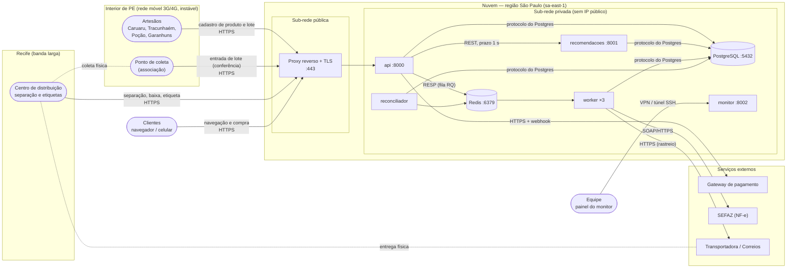

# Infraestrutura de Software (SO): topologia, rede, protocolos, benchmark e implantação

Documento da parte de SO da planilha do PI (Unidades 1 e 2). Cada seção responde a um
critério; a tabela abaixo é o índice.

| Critério da planilha | Peso | Onde |
|---|---|---|
| Topologia e arquitetura de comunicação | 20% | [1. Topologia](#1-topologia) |
| Requisitos de rede a partir do negócio | 17% | [2. Requisitos de rede](#2-requisitos-de-rede-a-partir-do-negócio) |
| Protocolos/APIs definidos | 13% | [3. Protocolos](#3-protocolos-e-apis) |
| Benchmarking (latência/vazão/perda/jitter) | 20% | [4. Benchmark](#4-benchmark-de-rede) e [`evidencias/so/`](../evidencias/so/) |
| Painel de monitoramento | 17% | [5. Painel](#5-painel-de-monitoramento) (`http://localhost:8002`) |
| Plano de implantação/migração | 13% | [6. Implantação em 3 cenários](#6-plano-de-implantação-em-3-cenários-com-orçamento) |

Threads, sincronização e condição de corrida (o outro lado de SO) estão no
[README, seção Infraestrutura de Software](../README.md#infraestrutura-de-software).

---

## 1. Topologia

O Origem vende artesanato de comunidades do interior de Pernambuco. O fluxo físico é
**produção → coleta → estoque → pedido → entrega**; a rede acompanha esse fluxo.



Como cada parte do domínio aparece na rede:

| Etapa do domínio | Quem | Rede | No código |
|---|---|---|---|
| Produção | artesão cadastra a peça e o lote (validade, quantidade) | celular, 3G/4G instável | `POST /estoque/produtos`, `POST /estoque/produtos/{codigo}/lotes` |
| Coleta | associação confere e dá entrada | 4G / Wi-Fi da associação | `POST /estoque/produtos/{codigo}/lotes` |
| Estoque | plataforma | nuvem, rede privada | `dominio/` (lista, hash, árvore, lotes por validade) |
| Pedido | cliente compra | banda larga ou móvel | `POST /pedidos` (lock no Postgres) → fila Redis → worker |
| Entrega | centro de distribuição separa e despacha | banda larga | `POST /estoque/pedidos/processar` (saída FEFO); worker → transportadora |

Hoje, no Docker Compose, todos os serviços estão na mesma rede bridge e algumas portas
(5432, 6379) são publicadas no host para os testes. Em produção só o proxy tem IP público
(ver [seção 6](#6-plano-de-implantação-em-3-cenários-com-orçamento)).

---

## 2. Requisitos de rede a partir do negócio

Cada requisito sai de uma necessidade do negócio e, quando possível, de uma medida.

| # | Necessidade do negócio | Requisito de rede | Como foi definido / verificado |
|---|---|---|---|
| R1 | Cliente desiste se a página demora | Página do produto com p95 ≤ 300 ms no servidor, no cenário moderado | Benchmark (seção 4) |
| R2 | Compra paga não pode sumir | Perda 0% no checkout; a fila e o banco toleram queda do Redis | Parte 1: lock + fila + reconciliador; benchmark mede perda |
| R3 | Recomendação é "bom ter" | Se `recomendacoes` estiver lenta ou fora, a página sai em ≤ 1 s sem a seção | Prazo de 1 s + disjuntor (`app/recomendacoes_cliente.py`); teste com rede degradada (seção 4) |
| R4 | Artesãos e clientes do interior usam 3G/4G | Respostas pequenas; o cliente tolera RTT alto e perda (retentar sem duplicar) | Tamanho médio por resposta medido no benchmark; retentativa idempotente no `POST` (job id `pedido-<id>`) |
| R5 | Usuários estão no Nordeste | Região de nuvem com menor RTT | Medido daqui (TCP connect, 6 amostras): **São Paulo ~72 ms × Virgínia (EUA) ~121 ms** |
| R6 | Equipe acompanha a loja em tempo real (telemetria) | Painel atualizado a cada 1 s sem pesar na rede | `/api/monitor` incremental: **~16–19 kB sem compressão → ~3 kB com gzip** (~6×) por segundo por pessoa olhando |
| R7 | Picos (Natal, Fenearte, Black Friday) | Suportar 100 usuários simultâneos sem perda | Benchmark cenário alto: revelou o gargalo do pool de conexões (seção 4) |
| R8 | Dados de clientes e pagamentos | Só o proxy exposto; TLS na borda; serviços internos sem porta pública; `docker.sock` só leitura | Topologia (seção 1) e compose |

Banda estimada por cenário a partir do benchmark (vazão em kB/s medida, nível de aplicação,
sem TLS nem imagens; as fotos dos produtos iriam por CDN): ver a tabela da seção 4.

---

## 3. Protocolos e APIs

| Enlace | Protocolo | Porta | Modo | Por quê | Alternativa descartada |
|---|---|---|---|---|---|
| Cliente/artesão → proxy | HTTPS (TLS 1.3, HTTP/1.1 ou 2) | 443 | síncrono | Padrão de navegador e celular; criptografia na rede pública | — |
| Proxy → api | HTTP/REST + JSON | 8000 | síncrono | Rede privada; JSON é legível e testável com `curl` | — |
| api → recomendacoes | HTTP/REST + JSON, `X-Request-ID` | 8001 | síncrono, prazo 1 s, disjuntor | A página precisa da resposta agora; o id liga os logs dos dois serviços | gRPC: ganho de latência pequeno perto do custo de protobuf/HTTP2 para a equipe; mensageria não serve para consulta que espera resposta |
| api → Redis → worker | RESP sobre TCP (fila RQ) | 6379 | assíncrono | Pós-venda (nota fiscal, 3 s) não pode segurar a compra; job id `pedido-<id>` evita duplicar | Chamar o worker por HTTP: perderia o pedido se o worker estivesse fora |
| Serviços → Postgres | protocolo do PostgreSQL sobre TCP, pool de conexões | 5432 | síncrono | Transações e `SELECT … FOR UPDATE` para o estoque | — |
| worker → SEFAZ | SOAP sobre HTTPS (NF-e) | 443 | assíncrono (no worker) | É o padrão exigido pela SEFAZ (simulado com `sleep(3)`) | — |
| api ↔ pagamento | HTTPS + webhook | 443 | assíncrono | Confirmação chega depois, por webhook assinado | Polling: gasta banda e atrasa |
| monitor → Docker | HTTP sobre socket Unix (`docker.sock`, só leitura) | — | pull (2 s) + fluxo `/events` | Única forma de ler status, limites, reinícios e OOM dos containers | — |
| monitor → serviços (sondas) | HTTP `GET /`, RESP `PING`, `SSLRequest` do Postgres | 8000, 8001, 6379, 5432 | 1 s | Cada sonda fala o protocolo real do serviço: testa mais que "a porta abriu" | Só `connect()` TCP: não detecta serviço travado |
| Navegador → painel | HTTP polling 1 s, JSON incremental (`?desde=`) + gzip | 8002 | pull | Simples, atravessa proxy/VPN; só manda o que é novo | WebSocket: mais peças móveis para o mesmo resultado em 1 req/s |

As APIs HTTP estão descritas em `http://localhost:8000/docs` (api, incluindo `/estoque`) e
`http://localhost:8001/docs` (recomendacoes), geradas pelo FastAPI (OpenAPI).

---

## 4. Benchmark de rede

**O que mede:** latência (p50/p95/p99), vazão (respostas/s e kB/s), jitter (média de |Δ| entre
latências seguidas do mesmo usuário, ideia da RFC 3550) e perda (timeout, erro de conexão ou
HTTP 5xx; 409 "sem estoque" é resposta de negócio, não perda).

**Como:** [`rede/benchmark.py`](../rede/benchmark.py), cliente assíncrono (httpx) rodando
**dentro da rede do Compose**. Usuários virtuais em circuito fechado com "tempo de pensar"
exponencial (média 0,2 s) e o mix do negócio: 70% página do produto (`GET /produtos/{id}`, que
chama o `recomendacoes` por REST), 20% busca no catálogo (`GET /estoque/busca`), 10% compra
(`POST /pedidos`). Cenários: 5 / 25 / 100 usuários simultâneos; 20 s por rodada; **3 repetições**;
timeout de 3 s. Máquina: i5-1035G1 (4 núcleos / 8 threads), Docker Desktop + WSL2, 8 CPUs e
3,7 GB para os containers; o cliente divide a máquina com os serviços. Dados: seed padrão
(2.000 produtos, 80 mil pedidos).

```bash
docker compose run --rm --no-deps -v ./rede:/code/rede -v ./evidencias:/code/evidencias \
    api python -m rede.benchmark --rotulo normal          # 3 cenários × 3 repetições
rede/degradar.sh recomendacoes                            # tc netem: 200 ± 100 ms, 10% de perda
rede/degradar.sh recomendacoes limpar
```

Resultados completos: [`evidencias/so/benchmark_rede.md`](../evidencias/so/benchmark_rede.md)
(e `.csv` com cada rodada). Mediana das 3 repetições:

| Condição | Cenário | Vazão (resp/s) | Vazão (kB/s) | p50 (ms) | p95 (ms) | Jitter (ms) | Perda |
|---|---|---:|---:|---:|---:|---:|---:|
| **Antes** da correção | baixo (5) | 22,5 | 18,9 | 16 | 37 | 10 | 0% |
| | moderado (25) | 93,8 | 79,2 | 33 | 135 | 42 | 0% |
| | **alto (100)** | **0,7** | 1,4 | 669 | 764 | — | **97,6%** |
| **Depois** da correção | baixo (5) | 22,2 | 18,5 | 18 | 40 | 12 | 0% |
| | moderado (25) | 88,1 | 73,8 | 57 | 213 | 54 | 0% |
| | **alto (100)** | **60,2** | 50,1 | 915 | **3.964** | 1.232 | **0%** |
| Depois, **rede degradada** no `recomendacoes` | moderado (25) | 94,9 | 58,9 | 23 | 190 | 65 | 0% (100% das páginas sem recomendações) |

### O que os números dizem

1. **O gargalo do cenário alto era o pool de conexões, não a rede.** Antes: 97,6% de perda, só
   timeouts. O log da api mostrava `QueuePool limit of size 5 overflow 10 reached`. O
   `GET /produtos/{id}` segurava a conexão do banco enquanto esperava até 1 s pela chamada REST
   ao `recomendacoes`: com 100 usuários, as 15 conexões acabavam e cada requisição esperava até
   30 s na fila do pool. Até a busca, que não usa o banco, deu timeout, porque as 40 threads da
   api estavam todas presas nessa espera.
2. **Falha metaestável.** Depois da carga a api continuou fora do ar por minutos (health check
   com timeout de 40 s, container `unhealthy`): o cliente desistia em 3 s e mandava outra
   requisição, mas o servidor seguia processando as abandonadas. A 3ª repetição do "antes" nem
   conseguiu começar. Lição para o plano: limitar filas e desistir cedo (`pool_timeout` curto),
   senão a sobrecarga se alimenta sozinha.
3. **Correção** ([`app/main.py`](../app/main.py), [`app/database.py`](../app/database.py)):
   devolver a conexão ao pool **antes** da chamada externa e dimensionar o pool (20 + 10,
   `pool_timeout` 5 s; cabe nas 100 conexões do Postgres com os outros serviços).
   Resultado: perda de 97,6% → **0%** e vazão de 0,7 → **60 resp/s** no cenário alto.
4. **O teto agora é um processo Python.** Com 100 usuários a perda é zero, mas o p95 vai a ~4 s e
   a vazão (60 resp/s) fica *abaixo* da do moderado (88). Os logs mostram a chamada REST com
   p95 de 145 ms, e até a busca (sem banco, sem rede) tem p95 de 3,5 s: a espera é na fila da
   própria api, antes da rota. Um único processo uvicorn, com as rotas síncronas dividindo um
   pool de 40 threads sob o GIL, atende ~60–90 resp/s. A Lei de Little fecha a conta:
   100 usuários ÷ 60 resp/s = 1,67 s por ciclo − 0,2 s pensando ≈ 1,5 s de resposta média.
   Mais usuários só aumentam a fila, e a disputa entre threads ainda derruba a vazão. A saída é
   escalar horizontalmente (mais processos ou VMs): é o cenário alto da seção 6, que exige antes
   tirar do processo o estado em memória do `/estoque`.
5. **Requisito R1** (p95 ≤ 300 ms no moderado): atendido (213 ms; faixa 168–349 ms nas 3
   repetições, então está no limite). No cenário alto **não** é atendido numa máquina só, o que
   justifica a arquitetura do cenário alto.
6. **Rede degradada (R3).** Com 200 ± 100 ms de atraso e 10% de perda no `recomendacoes`
   (`tc netem`), o painel mostrou o jitter da sonda subir de ~1 ms para ~49 ms e o p95 para 672 ms.
   A loja **não** sofreu: 0% de perda, p95 de 190 ms e p50 até *menor* (23 ms), porque o
   disjuntor abriu na primeira chamada acima de 1 s e as páginas saíram sem recomendações
   (100%), sem esperar o serviço lento. A vazão em kB/s caiu de 74 para 59 porque as respostas
   ficaram sem a lista de recomendações. É a degradação graciosa pedida pelo R3, com um custo
   visível: a maioria das chamadas ainda caberia em 1 s, mas uma falha abre o disjuntor por
   15 s. Abrir só depois de N falhas numa janela recuperaria parte das recomendações.
7. **Jitter acompanha a fila:** 10 ms (baixo) → 54 ms (moderado) → 1,2 s (alto). Em rede local a
   variação não vem dos cabos, vem da contenção nos servidores; é por isso que o painel mostra
   jitter por serviço.
8. **Banda:** mesmo no pico a api serve ~50–80 kB/s (≈ 0,4–0,6 Mbit/s) de JSON. Os pacotes do
   Lightsail (4–6 TB/mês) sobram; o que pesaria são as fotos dos produtos, que devem ir por
   CDN/armazenamento de objetos e não pela api.

Limites da medição: cliente e serviços na mesma máquina (o cliente usou ~0,9 núcleo no cenário
alto); rede virtual do Docker, sem a internet do cliente no meio; o RTT real até a nuvem (~72 ms
para São Paulo, R5) se soma a estes números.

---

## 5. Painel de monitoramento

`http://localhost:8002` (serviço `monitor` do Compose). As métricas de rede são reais, coletadas
pelo coletor com threads ([README](../README.md#painel-do-monitor-aed--infra)):

| Aba | Métricas de rede |
|---|---|
| 2 · Containers | Vazão de rede ↓↑ por container (bytes/s, da diferença entre duas leituras de `stats`), pacotes perdidos e erros de interface |
| 3 · Serviços | Latência média, p95, **jitter** e **perda** das últimas 60 sondas de cada serviço; disponibilidade; tempo no estado atual; linha do tempo de quedas e voltas |

Para ver as métricas mudarem durante a apresentação: rodar o benchmark (cenário alto) com o
painel aberto, ou degradar a rede do `recomendacoes` com `tc netem` (comandos na seção 4).

---

## 6. Plano de implantação em 3 cenários com orçamento

Os cenários são os mesmos do benchmark (usuários simultâneos): **baixo = 5** (dia comum),
**moderado = 25** (campanha, feira), **alto = 100** (Natal, Fenearte, Black Friday).
Provedor de referência: **Amazon Lightsail** (preço fixo mensal, fácil de prever, já inclui
transferência de dados) na **região São Paulo**, disponível desde junho/2026 e escolhida pelo
RTT medido (R5). Os mesmos números servem de base para EC2/RDS se o projeto crescer.

**Preços de lista consultados em 26/11/2026** (US$/mês; conferir na calculadora da AWS antes de
contratar, porque São Paulo pode custar mais que as regiões dos EUA):
instância 1 GB = 7, 2 GB = 12, 4 GB = 24, 8 GB = 44; balanceador de carga = 18; banco
gerenciado PostgreSQL a partir de 15 (1 GB, 40 GB SSD); o plano de alta disponibilidade custa cerca
de 2×. Câmbio: R$ 5,87 (fechamento de 18/11/2026).

| | Baixo | Moderado | Alto |
|---|---|---|---|
| Arquitetura | 1 VM com o Docker Compose inteiro (como hoje) | 1 VM para os serviços + **Postgres gerenciado** | **2 VMs** de aplicação atrás de um **balanceador** + Postgres gerenciado **com alta disponibilidade** + Redis numa VM própria |
| Máquinas | Lightsail 4 GB / 2 vCPU (soma dos `mem_limit` = 2,3 GB) | Lightsail 8 GB / 2 vCPU + banco 1 GB | 2× Lightsail 8 GB + banco HA + Lightsail 2 GB (Redis) + balanceador |
| Custo (US$/mês) | 24 + ~2 de snapshots = **~26** | 44 + 15 = **59** | 88 + ~30 + 12 + 18 = **~148** |
| Custo (R$/mês) | **~R$ 153** | **~R$ 346** | **~R$ 869** |
| Banco | Container `postgres` com volume; snapshot diário da VM | Gerenciado: backup automático, dado separado da computação | Gerenciado HA: réplica em outra zona, failover automático |
| Ponto único de falha | A VM inteira | A VM de aplicação | Nenhum na aplicação; o balanceador é gerenciado |
| Alternativa mais barata | Oracle Cloud Always Free (Ampere A1, R$ 0). Risco real: a Oracle reduziu o limite gratuito à metade em junho/2026 (para 2 OCPU / 12 GB). Serve para demo, não para a loja | — | — |

**Quando passar para o próximo cenário** (gatilhos lidos no próprio painel do monitor, sustentados por 15 min):
- p95 da sonda da `api` acima de 300 ms (requisito R1), ou perda acima de 0% (aba 3);
- CPU da VM acima de 70% (aba 1) ou memória de algum container acima de 85% do `mem_limit` (aba 2: alerta);
- qualquer evento de OOM ou reinício de container (abas 1 e 2).

**Migração baixo → moderado** (janela de manutenção curta, de madrugada):
1. Criar o Postgres gerenciado e liberar acesso só a partir da VM (regra de firewall).
2. Colocar a loja em manutenção (proxy devolve 503 para `POST /pedidos`) e esperar a fila do RQ esvaziar.
3. `pg_dump` do container → `pg_restore` no gerenciado; conferir contagem de produtos e pedidos.
4. Trocar `DATABASE_URL` no `.env`, remover o serviço `postgres` do compose, `docker compose up -d`.
5. Rodar `test_concorrencia.py` e `evidencia_comunicacao.py` contra produção; reabrir a loja.
   Volta atrás: o volume antigo continua lá; basta voltar o `DATABASE_URL`.

**Migração moderado → alto:**
1. Criar a segunda VM a partir de um snapshot da primeira; mover o Redis para a VM própria
   (`REDIS_URL`), porque as duas VMs precisam da mesma fila.
2. Criar o balanceador com o certificado TLS e registrar as duas VMs (health check em `GET /`).
3. Ativar alta disponibilidade no banco gerenciado.
4. Limitação conhecida: o `/estoque` (modelo de domínio de AED) guarda o estado em memória
   na api; com duas instâncias cada uma teria o seu. Antes de escalar, é preciso persistir esse
   estado no Postgres ou fixar o `/estoque` numa instância só.
5. Um `monitor` por VM (ele lê o `/proc` e o `docker.sock` da própria máquina).

**Deploy pelo pipeline (CD):** o GitHub Actions já faz build e testes (`.github/workflows/ci.yml`).
O passo de deploy em nuvem seria: publicar as imagens no GitHub Container Registry com a tag do
commit → entrar na VM por SSH (chave em *secret* do repositório) → `docker compose pull && docker
compose up -d --wait` → rodar as sondas (`curl -f` em `/` da api e do recomendacoes). Se falhar,
voltar para a tag anterior. Falta só a conta na nuvem para ligar esse passo.

Fontes dos preços: [Lightsail bundles (AWS)](https://docs.aws.amazon.com/lightsail/latest/userguide/amazon-lightsail-bundles.html),
[FAQ de cobrança do Lightsail (banco a partir de US$ 15)](https://docs.aws.amazon.com/lightsail/latest/userguide/amazon-lightsail-frequently-asked-questions-faq-billing-and-account-management.html),
[FAQ do Lightsail (balanceador US$ 18)](https://aws.amazon.com/lightsail/faq/),
[Lightsail em São Paulo (jun/2026)](https://aws.amazon.com/pt/about-aws/whats-new/2026/06/amazon-lightsail-aws-regions/),
[Oracle Always Free](https://docs.oracle.com/iaas/Content/FreeTier/resourceref.htm) e
[corte do limite gratuito (InfoQ, jul/2026)](https://infoq.com/news/2026/07/oracle-cloud-free-tier-limits/),
[câmbio em 18/11/2026](https://brasil61.com/n/dolar-fecha-em-alta-de-1-45-e-chega-a-r-5-87-bras2617492.amp).
